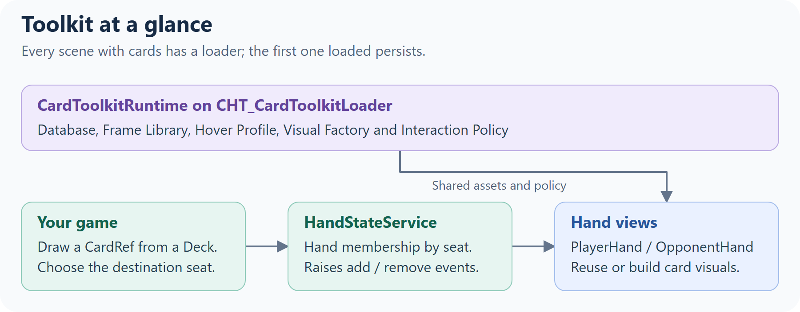
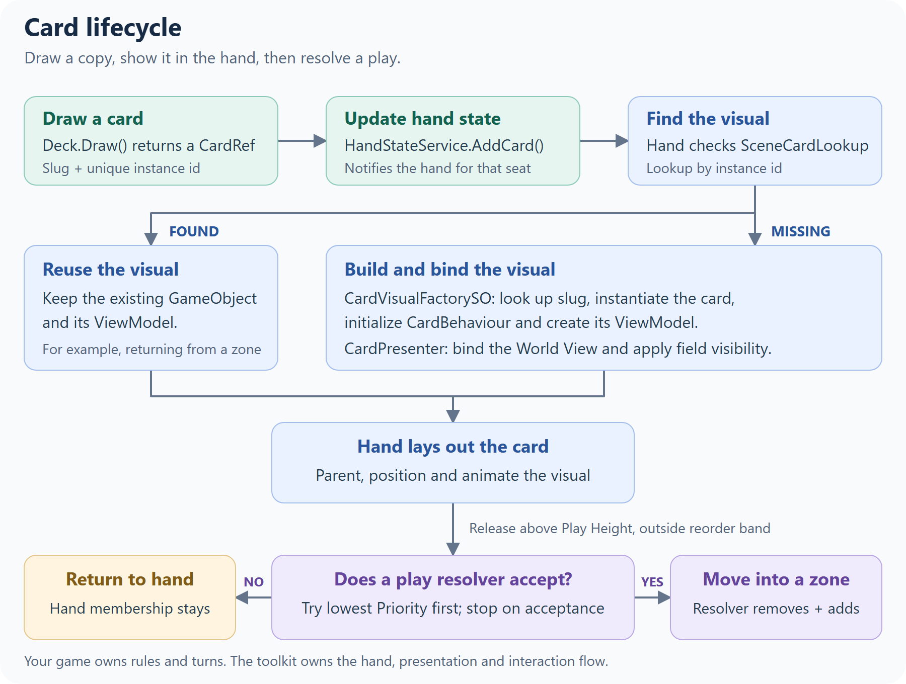
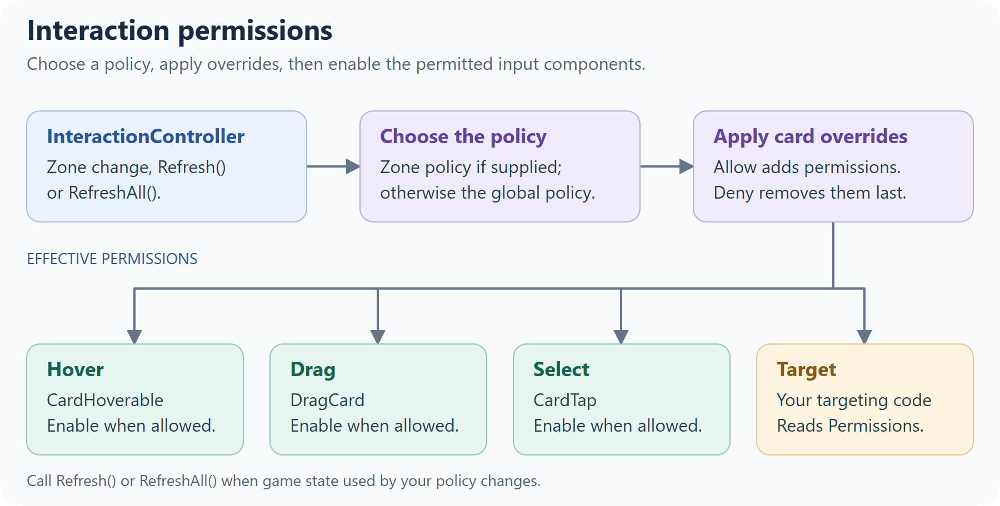
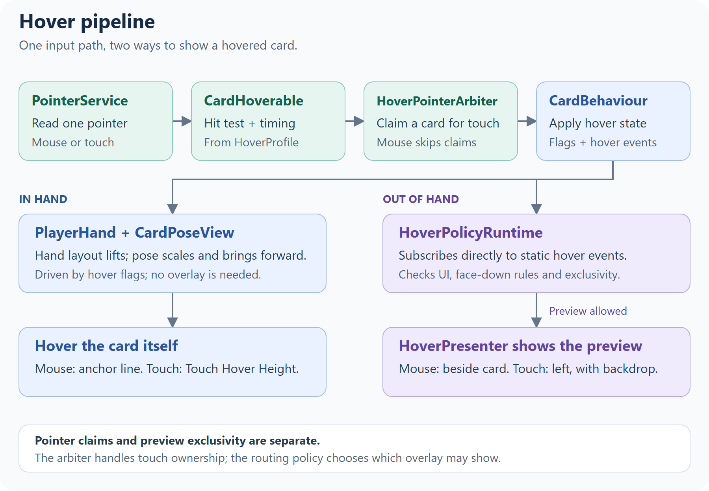
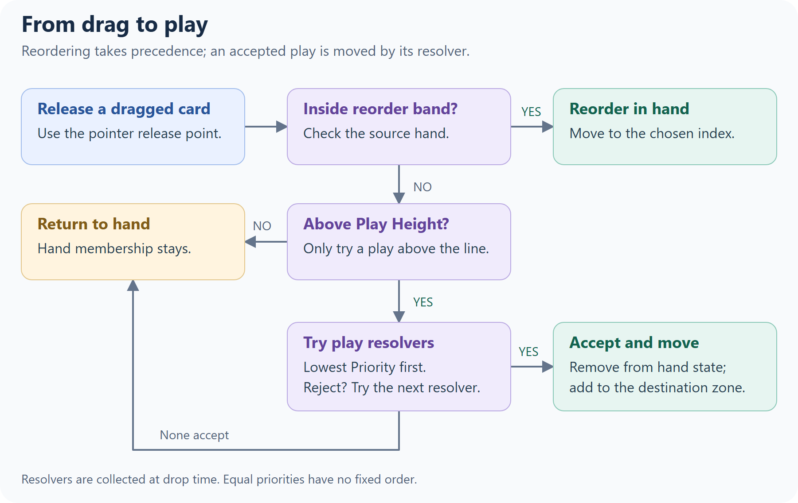
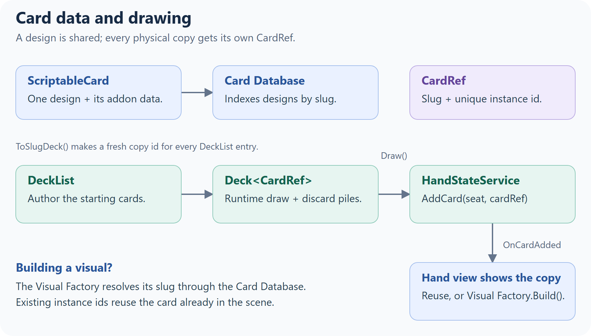
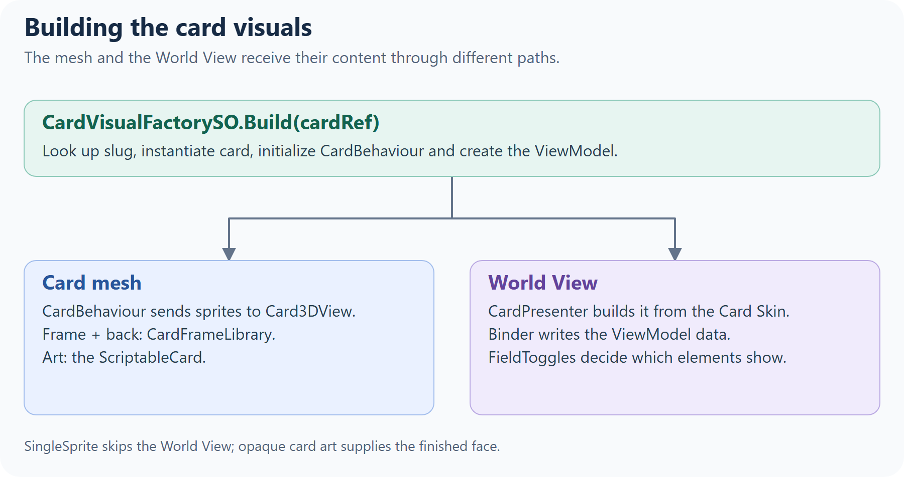
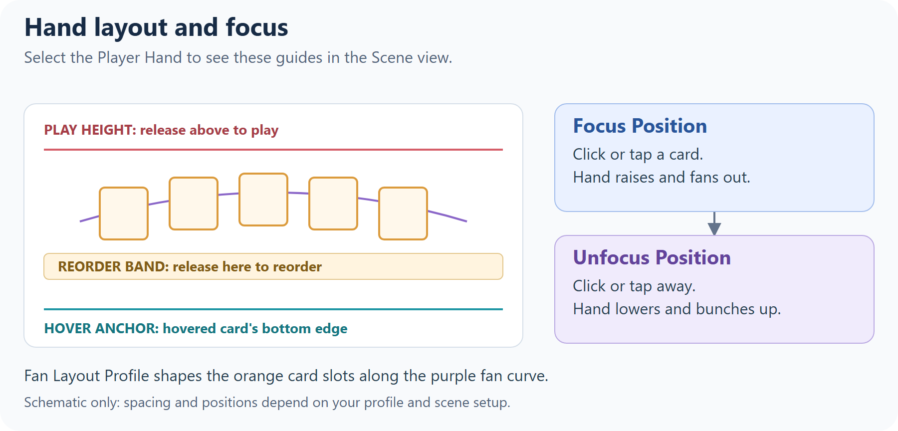

# Card Hand Toolkit — API Hub

> How the toolkit fits together, a guide to each part, and a reference entry for every public type.

---

## How to Use This Hub

1. **Read [Concepts](#concepts)** for the big picture.
2. **Read the [Module](#modules)** for the part you're working on. Each one is a short guide: how its pieces fit, common tasks and code.
3. **Look types up in the [A–Z Type Index](#az-type-index).** Each entry says what the type does, then lists its **Inspector** settings and key **Members**, and links to its module under **Guide**.

New to the toolkit? Start with the [Quick Start](QuickStart.md).

---

## Table of Contents

- [Concepts](#concepts)
- [Modules](#modules)
  - [Interaction](#interaction)
  - [Zones & Play](#zones--play)
  - [Card Data & Decks](#card-data--decks)
  - [Card Visuals](#card-visuals)
  - [Hands & Layout](#hands--layout)

- [A–Z Type Index](#az-type-index)
- [FAQ](FAQ.md)

---

## Concepts



- **One runtime hub.** [`CardToolkitRuntime`](#cardtoolkitruntime-c), on the `CHT_CardToolkitLoader` prefab, holds the project-wide references every system reads. Reach it through `CardToolkitRuntime.Instance`.
- **Your code owns the game; the toolkit shows it.** Hands never add or remove cards on their own: your code changes [`HandStateService`](#handstateservice-l) (and your [`Deck`](#deck-l)), and the hands follow. The toolkit has no rules engine. Costs, suits, turns and phases belong to your game, through addons, view models and interaction policies.
- **A card has three parts.** A [`ScriptableCard`](#scriptablecard-c) is the design, a [`CardRef`](#cardref-l) is one copy of it in play, and the card GameObject shows that copy. On the GameObject, [`CardBehaviour`](#cardbehaviour-l) holds its state, the card mesh and World View draw it, and [`CardHoverable`](#cardhoverable-c), [`DragCard`](#dragcard-c) and [`CardTap`](#cardtap-c) handle the player's input.

### Who owns what?

| Information | Owner |
| --- | --- |
| A card design and its addon data | [`ScriptableCard`](#scriptablecard-c), listed in the [`CardDatabase`](#carddatabase-c). |
| One copy's identity | [`CardRef`](#cardref-l): a slug plus a unique instance id. [`CardBehaviour`](#cardbehaviour-l) carries that identity on its GameObject. |
| Draw and discard pile contents | Your runtime [`Deck<CardRef>`](#deck-l). |
| Hand membership, by seat | [`HandStateService`](#handstateservice-l). Hand views follow its events. |
| Existing card visuals | [`SceneCardLookup`](#scenecardlookup-l) maps instance ids to [`CardBehaviour`](#cardbehaviour-l)s; it doesn't own game state. |
| Runtime display data and capabilities | The card's [`ICardViewModel`](#icardviewmodel-e). Your code changes it and raises `OnChanged`. |
| Face-down, exhausted, hover and selection state | [`CardBehaviour`](#cardbehaviour-l), which refreshes the card's views. |
| Binding and field visibility | [`CardPresenter`](#cardpresenter-sealed-l) and [`HoverPresenter`](#hoverpresenter--ihoverpresenter-ce), using the ViewModel and [Card Skin](#cardskin-c). |
| Rules, turns and effects | Your game code. |

### Card lifecycle



The hand checks [`SceneCardLookup`](#scenecardlookup-l) before building a visual, so a card returning from a zone keeps its existing GameObject and ViewModel. In [SingleSprite mode](#finished-card-images-singlesprite-mode), the presenter skips the World View. The [Card Data & Decks](#card-data--decks), [Card Visuals](#card-visuals) and [Zones & Play](#zones--play) guides cover each step.

### Extend, configure or learn

Every A–Z entry carries a tag:

- **[E] Extend:** interfaces and base classes you implement for your own behavior: [`ICardZone`](#icardzone-e), [`IPlayResolver`](#iplayresolver-e), [`ILockableZone`](#iplayheightzone--ireorderbandzone--ilockablezone-e), [`IZoneHoverAnchorProvider`](#izonehoveranchorprovider-e), [`CardAddon`](#cardaddon-e), [`ICardViewModel`](#icardviewmodel-e), [`ICardViewModelFactory`](#icardviewmodelfactory-e), [`ICardViewBinder`](#icardviewbinder-e), [`ICardView`](#icardview-e), [`IContextualSwitcher`](#icontextualswitcher-e), [`IInteractionPolicy`](#iinteractionpolicy-e), [`IInteractionOverride`](#iinteractionoverride--cardinteractionoverride-ce), [`IHoverPresenter`](#hoverpresenter--ihoverpresenter-ce), [`IPointerSource`](#pointerservice--ipointersource-le), [`IEmptyDeckPolicy`](#iemptydeckpolicy--reshuffleonempty--noreshufflepolicy-ec), [`ICardVisualFactory`](#icardvisualfactory-e).
- **[C] Configure:** components and assets you set up in the Inspector: [`CardToolkitRuntime`](#cardtoolkitruntime-c), [`PlayerHand`](#playerhand-c), [`OpponentHand`](#opponenthand-c), the [example zones](#the-example-zones), [`CardSkin`](#cardskin-c), [`CardFrameLibrary`](#cardframelibrary-c), [`CardVisualFactorySO`](#cardvisualfactoryso-c), [`HoverProfile`](#hoverprofile-c), [`HoverRoutingPolicy`](#hoverroutingpolicy-c), [`FanLayoutProfile`](#fanlayoutprofile-c).
- **[L] Learn:** types you call or read but don't change: [`CardBehaviour`](#cardbehaviour-l), [`HandStateService`](#handstateservice-l), [`Deck`](#deck-l), [`CardPresenter`](#cardpresenter-sealed-l), [`SceneCardLookup`](#scenecardlookup-l), [`InteractionController`](#interactioncontroller-l).

> **Toolkit-owned assets:** assets prefixed `CHT_` (and everything in `Samples/`) are replaced when you update the package. Configure your own copies; the Setup Wizard creates them in `Assets/CardHandToolkit/Config/`.

---

## Modules

### Interaction

_(hover, drag and tap, and what each card allows)_

- Includes: `InteractionController`, `IInteractionPolicy`, `IInteractionPolicyProvider`, `DefaultInteractionPolicy`, `IInteractionOverride`/`CardInteractionOverride`, `CardHoverable`, `DragCard`, `CardTap`, `HoverPolicyRuntime`, `HoverRoutingPolicy`, `HoverProfile`, `IHoverPresenter`/`HoverPresenter`, `HoverAnchor`, `PointerService`/`IPointerSource`.



#### The components on a card

The card prefab (`CHT_CardPlayable_Template`, and your `CardPlayable_User` variant) has one component per interaction. Each reads the pointer from `PointerService`. Hover and tap ignore the pointer while it's over UI.

- **`CardHoverable`:** hovering. See [Hover](#hover) below.
- **`DragCard`:** dragging, which starts from a hovered card once the pointer moves past a threshold. Tune the feel on your card prefab: **Mouse Drag Threshold** and **Touch Drag Threshold** (pixels), **Tilt Strength**, **Lerp Speed** (smoothing), and **Drag Plane Z** (the depth the card follows while dragged).
- **`CardTap`:** clicking or tapping. See [Tap and select](#tap-and-select) below.
- **`InteractionController`:** switches the three above on or off from the card's permissions.

#### Permissions and policies

`DefaultInteractionPolicy`, used unless you replace it, allows:

| Zone                                      | Hover | Drag | Select | Target |
| ----------------------------------------- | :---: | :--: | :----: | :----: |
| `Hand` (the Player Hand)                  |   ✓   |  ✓   |   ✓    |        |
| `Board`                                   |   ✓   |      |   ✓    |   ✓    |
| `OpponentHand`, `Deck`, `Discard`, others |       |      |        |        |

There are three ways to change this, from broadest to narrowest:

1. **Globally:** write a `ScriptableObject` that implements `IInteractionPolicy`, create an asset from it, and assign it to **Override Policy Asset** on `CardToolkitRuntime` (on your `CHT_CardToolkitLoader`).
2. **For one zone:** implement `IInteractionPolicyProvider` on the zone, or on a component next to it. Its `Policy` replaces the global policy for cards in that zone.
3. **For one card:** add a `CardInteractionOverride` and set its **Allow** and **Deny** masks. Deny wins over Allow.

A policy is asked again whenever a card changes zone. If yours also depends on game state, such as whose turn it is, call `InteractionController.RefreshAll()` when that state changes (or `Refresh()` on one card's controller):

```csharp
using CardHandToolkit;
using UnityEngine;

[CreateAssetMenu(menuName = "My Game/Turn Interaction Policy")]
public class TurnInteractionPolicy : ScriptableObject, IInteractionPolicy
{
    public static bool IsMyTurn = true; // set by your turn system

    readonly DefaultInteractionPolicy defaults = new();

    public InteractionPerms GetPermissions(CardBehaviour card, InteractionContext ctx)
    {
        InteractionPerms perms = defaults.GetPermissions(card, ctx);
        if (!IsMyTurn)
            perms &= ~InteractionPerms.Drag; // look, but don't play
        return perms;
    }
}

// In your turn system:
TurnInteractionPolicy.IsMyTurn = false;
InteractionController.RefreshAll();
```

`InteractionContext` gives the card's `Zone` and its `Owner`: `Local` in the Player Hand, `Opponent` in an opponent hand, and `Neutral` everywhere else. To read what a card allows, for example before letting your targeting code pick it, use `card.GetComponent<InteractionController>().Permissions`.

#### Hover

The toolkit has two kinds of hover:

- **In the hand,** the hovered card lifts, scales and comes forward. Cards can only be hovered while the hand is focused: clicking or tapping a card in the hand raises and fans it out (from its **Unfocus Position** to its **Focus Position**), and clicking or tapping anywhere else lowers it. With a mouse, the card lifts until its bottom edge sits on the Player Hand's **Hover Anchor** line. With touch, hold a finger on the card, and it lifts by **Touch Hover Height**.
- **Out of the hand** (on the board, for example), a large preview of the card appears in an overlay. With a mouse, it appears next to the card after **Mouse Out Of Hand Hover Delay**. With touch, it appears at the left edge after a long press (**Touch Long Press Delay**; moving more than **Touch Long Press Move Threshold** pixels cancels it), and tapping the backdrop closes it.

Most of the hover feel lives in the **`HoverProfile`** assigned on `CardToolkitRuntime`: the delays above, **Hover Scale**, **Hover Anim Time**, **Hover Z Offset**, the overlay offsets, and the highlight colors (**Default Highlight Color** for hovered or selectable cards, **Selected Highlight Color** for selected ones).

Out-of-hand previews are routed by **`HoverPolicyRuntime`** (on `CHT_CardToolkitLoader`) using a **`HoverRoutingPolicy`** asset (`CHT_HoverRoutingPolicy` by default):

- **Exclusive Preview:** only one preview at a time. **Last Enter Wins** decides whether a newly hovered card replaces it.
- **Suppress When Pointer Over UI:** no preview while the pointer is over UI.
- **Allow Face Down Preview:** off by default, so face-down cards never show a preview.

The preview itself is drawn by a **`HoverPresenter`** in the scene, from the card's World View; see [Card Visuals](#card-visuals) for its layout. If the scene has none, `HoverPolicyRuntime` creates one from its **Presenter Prefab**.



`HoverPointerArbiter` claims a card per touch pointer; mouse claims are skipped by default. Overlay exclusivity is a separate decision made by `HoverPolicyRuntime`, which subscribes directly to `CardBehaviour.OnAnyHoverEnter` and `OnAnyHoverExit`.

For a custom hand's mouse-hover placement, implement [IZoneHoverAnchorProvider](#izonehoveranchorprovider-e). The Player Hand uses [HoverPoseSolver](#hoverposesolver-l) to align the card's bottom edge with that anchor.

#### Tap and select

A click (press and release on the same card) or a short tap calls `TapCard()` on the card. A touch held longer than **Touch Long Press Delay** counts as a hover instead.

- Every tap raises `OnCardTapped` on the card and the static `CardBehaviour.OnAnyCardTapped`.
- If the card is **selectable** (`card.SetSelectable(true)`, which also highlights it), a tap toggles it between selected and unselected and raises `OnCardSelected` / `OnCardUnselected` (and the static `OnAnyCardSelected` / `OnAnyCardUnselected`). You can also call `SetSelected(bool)` from code.

For example, to let the player pick a card from their hand:

```csharp
foreach (CardRef cardRef in HandStateService.Instance.GetHand(0))
    if (SceneCardLookup.TryGet(cardRef.InstanceId, out CardBehaviour card))
        card.SetSelectable(true);

CardBehaviour.OnAnyCardSelected += picked => Debug.Log($"Picked {picked.Definition.cardName}");
```

#### Pointer input

`PointerService` polls one `IPointerSource` once per frame, so every component sees the same pointer. On desktop the mouse is reported every frame; on touch devices the first finger is, and touch takes priority over the mouse. The toolkit picks the source for your project's input setting: the Input System when the package is installed and active, otherwise the legacy Input Manager. To drive cards from something else, such as a gamepad-controlled cursor, implement `IPointerSource` and call `PointerService.SetSource(yourSource)`. Both are in the `CardHandToolkit.Internal` namespace.

### Zones & Play

_(where cards live, and how a drag becomes a play)_

- Includes: `ICardZone`, `IPlayResolver`, `ILockableZone`, `IPlayHeightZone`, `IReorderBandZone`, `CardZoneTracker`, `ZoneType`, `ZoneCardFacing`, and the example zones `LineBoardZone` and `SingleSlotZone`.

#### Zones and resolvers

- A **zone** (`ICardZone`) holds and lays out cards: the hands, the board zones, and the deck and discard piles. A card belongs to the zone it's parented under, and its `CardZoneTracker` keeps track of which one that is.
- A **resolver** (`IPlayResolver`) decides whether to accept a card the player plays. The example board zones are both, but a resolver doesn't have to be a zone: an area that discards whatever is played onto it only needs to be a resolver.

#### How a play works



1. The player drags a card out of the Player Hand. Above the hand's **Play Height**, the card highlights.
2. When the card is released there, `DragCard` collects every active `IPlayResolver` in the loaded scenes, lowest `Priority` first. They're collected at each play, so zones added at runtime are included.
3. It calls `TryResolvePlay` on each with a `PlacementQuery`: the card, the zone it came from, and where the pointer was released (`screenPos`, and `pointerRay` from the camera through it). The first resolver that returns `allowed = true` takes the card, and the rest aren't asked.
4. If none accepts it, the card returns to its place in the hand.

Releasing the card over the hand itself (inside its reorder band) reorders the hand instead of playing.

**The resolver that accepts a card moves it.** The example zones do it in two steps:

1. Remove the card from where it came from: `HandStateService.Instance.RemoveCard(seat, card.ToCardRef())` for a hand (the hand then lets go of it), or `fromZone.RemoveCard(card)` for any other zone.
2. Add it with `AddCard(card)`, which parents it, applies the zone's **Card Facing**, and lays it out.

On the board, the default interaction policy lets a card be hovered and selected, but not dragged. See [Interaction](#interaction) to change that.

#### The example zones

- **`LineBoardZone`** lays cards out in a centered row, up to **Capacity** (default 40). **Spacing** squeezes to fit **Max Width**. `Cards` lists them left to right.
- **`SingleSlotZone`** holds one card at its **Slot** transform (or its own position). With **Allow Replace When Occupied**, a new card sends the old one back to its home hand. `Card` is the card in the slot, or `null`.
- Both have a **Priority** (default `1`), a **Drop Area**, a **Card Facing** applied to every card that enters (`FaceUp`, `FaceDown` or `KeepCurrent`), and a **Locked** checkbox. A locked zone rejects every play, but code can still place cards with `AddCard`.

> **By default, the example zones ignore where the card is dropped.** With **Drop Area** at `(0, 0)`, they accept a play anywhere above Play Height, so when several are unlocked, the lowest **Priority** takes every play (equal priorities have no fixed order). To let the drop point choose the zone, give each one a **Drop Area**: a rectangle in the zone's local units, centered on the zone (on the **Slot** for `SingleSlotZone`), drawn as a yellow gizmo when the zone is selected. A play released outside it passes to the next resolver. Otherwise, lock the zones that shouldn't take plays right now, as the sample does between rounds.

#### Moving cards from code

Game code can move cards between hands and zones directly:

```csharp
// Hand to zone: here, the opponent plays a card from its hand
HandStateService.Instance.RemoveCard(seat, cardRef);
if (SceneCardLookup.TryGet(cardRef.InstanceId, out CardBehaviour card))
    slot.AddCard(card);

// Zone to zone
slot.RemoveCard(card);
row.AddCard(card);

// Zone to hand: the hand finds the existing card and takes it back
row.RemoveCard(card);
HandStateService.Instance.AddCard(seat, card.ToCardRef());
```

`Sample_GameManager` uses the first two, and `SingleSlotZone` uses the third when it replaces a card.

#### Writing a resolver

Implement `IPlayResolver` on any component in the scene. This one destroys cards dropped on it:

```csharp
using CardHandToolkit;
using UnityEngine;

public class BurnPile : MonoBehaviour, IPlayResolver
{
    [SerializeField] Vector2 size = new Vector2(3f, 4f);
    [SerializeField] int priority = 0; // asked before the example zones (1)

    public int Priority => priority;

    public PlacementResult TryResolvePlay(PlacementQuery query)
    {
        if (!query.IsOver(transform, size))
            return default; // not accepted: the next resolver is asked

        HandStateService.Instance.RemoveCard(query.fromZone.SeatId, query.card.ToCardRef());
        Destroy(query.card.gameObject);
        return new PlacementResult { allowed = true };
    }
}
```

- The toolkit only reads `allowed`. `slotIndex`, `worldPos` and `worldRot` are there for your own code.
- Plays start from a hand with a Play Height (the Player Hand), so `query.fromZone` is that hand.
- `query.IsOver(target, size)` checks the release point against a rectangle centered on `target`. `query.TryGetLocalPoint(target, out Vector3 local)` gives the point itself, in `target`'s local space. Both use `target`'s local XY plane (the plane a zone's cards lie in), so they work at any depth, on a tilted table, and with perspective or orthographic cameras.
- **For games where placement matters,** use `TryGetLocalPoint` in your zone's `TryResolvePlay` and place the accepted card at `local` instead of at a fixed layout position. Store each card's position so `AlignCards` can restore it.
- To hold the cards it accepts, also implement `ICardZone` (`SingleSlotZone` is a short example to copy), and `ILockableZone` if your game needs to switch it off.

### Card Data & Decks

_(what a card is, and how cards get from a deck into a hand)_

- Includes: `ScriptableCard`, `CardAddon`, `CardDatabase`, `CardRef`, `DeckList`, `Deck`, `IEmptyDeckPolicy` (`ReshuffleOnEmpty`, `NoReshufflePolicy`), `HandStateService`, `SceneCardLookup`, `VisualDeck`, `VisualDiscard`.



#### Card data

- **`ScriptableCard`** is one card design: **Slug** (its unique id), **Card Name**, **Rules Text**, **Frame Key**, **Tags**, **Card Art** and **Addons**. Create one with **Create ▸ Card Toolkit ▸ Card**. The slug is filled in from the asset name when you create it. Keep it unique, and don't change it once your game has saves or data files that refer to it.
- **`CardAddon`** holds game-specific data such as cost or suit. Subclass it, then add one to a card with **+ Add New Addon** in the card's Inspector; it's saved inside the card asset. Read it with `card.GetAddon<T>()`. [Quick Start Section 6](QuickStart.md#quick-start-custom-data) walks through this.
- **`CardDatabase`** lists every card your game can build. `CardToolkitRuntime` indexes it by slug when it starts, and the Visual Factory looks cards up there. A card that's missing from it can't be built, and the error names its slug.

#### One card, many copies: `CardRef`

A `CardRef` is one copy of a card: a `CardSlug` (which design) plus an `InstanceId` (which copy). Two Fireballs in a deck share a slug but have different instance ids, and `CardRef`s compare by instance id.

- `DeckList.ToSlugDeck()` makes one for each card in the list. To make one yourself: `new CardRef(System.Guid.NewGuid().ToString("N"), "fireball")`.
- From a card in the scene: `card.ToCardRef()`. From a `CardRef` to its card in the scene: `SceneCardLookup.TryGet(cardRef.InstanceId, out CardBehaviour card)`.

#### Decks

A **`DeckList`** asset lists the cards in a deck; list a card twice for two copies. `deckList.ToSlugDeck(policy)` creates a runtime **`Deck<CardRef>`** in list order, so shuffle it before drawing. The `Deck` is a plain C# object that your game code owns.

| Member                                                                                             | What it does                                                                                                                                                          |
| -------------------------------------------------------------------------------------------------- | --------------------------------------------------------------------------------------------------------------------------------------------------------------------- |
| `Draw(count = 1)`                                                                                  | Takes cards from the top. When the draw pile is empty, it asks the empty-deck policy first, and returns fewer cards if the deck runs out.                             |
| `Peek(count = 1)`                                                                                  | The top cards, without drawing them.                                                                                                                                  |
| `InsertTop(card)`, `InsertBottom(card)`                                                            | Puts a card back into the draw pile.                                                                                                                                  |
| `Discard(card)`                                                                                    | Adds a card to the discard pile.                                                                                                                                      |
| `Shuffle()`, `ShuffleRange(start, count)`                                                          | Shuffles the draw pile, or part of it (a negative `start` counts from the bottom).                                                                                    |
| `Reshuffle()`                                                                                      | Moves the discard pile into the draw pile and shuffles.                                                                                                               |
| `Count`, `DiscardCount`, `SnapshotDrawPile()`, `SnapshotDiscardPile()`                             | Pile sizes and contents (draw pile: index 0 is top; discard pile: last entry is top).                                                                                  |
| `CardDrawn`, `CardAdded`, `CardDiscarded`, `Shuffled`, `Reshuffled`, `CountsChanged`, `EmptyEvent` | Events for your UI and rules. `CountsChanged` passes the draw and discard counts; `EmptyEvent` fires when a draw finds the deck empty and the policy can't refill it. |

The **empty-deck policy** decides what `Draw` does on an empty draw pile. `ReshuffleOnEmpty` (the default) shuffles the discard pile back in. `NoReshufflePolicy` doesn't, as in games where an empty deck ends the game. Implement `IEmptyDeckPolicy<CardRef>` for your own rule: return `true` once the draw pile has cards again.

```csharp
Deck<CardRef> deck = deckList.ToSlugDeck(new ReshuffleOnEmpty<CardRef>());
deck.Shuffle();

foreach (CardRef card in deck.Draw(5))
    HandStateService.Instance.AddCard(0, card); // seat 0: the local player
```

#### Hands: `HandStateService`

`HandStateService.Instance` is the single record of which cards are in each seat's hand. Seat `0` is the local player (the Player Hand's **Seat Id**), and opponents use `1` and up. Hand views never add or remove cards on their own: change a hand through the service, and every hand view with that seat follows.

- `AddCard(seat, cardRef)`: the hand shows the card, reusing it if it's already in the scene, so a card coming back from the board slides back in.
- `RemoveCard(seat, cardRef)`: the hand stops laying the card out and lets go of it. The card stays where it is, so move it to a zone, discard it or destroy it. `Clear(seat)` does this for every card in the hand.
- `GetHand(seat)`, `OnCardAdded`, `OnCardRemoved`.

#### Showing the deck and discard pile

`VisualDeck` and `VisualDiscard` (prefabs `CHT_DeckVisual` and `CHT_DiscardVisual`) show a `Deck`'s piles as stacks of cards. Bind them with `Initialize(deck)` after creating the deck.

Both share **Max Visible Layers** (default `8`, minimum `1`). The top layers use the normal fan layout; extra cards sit directly behind the bottom visible layer with separate depths to avoid flickering. Every card object is retained, and the last entry in each view's card list remains on top. The selected pile's gizmo previews the visible layers using the same layout.

- **With a `VisualDeck`,** the draw pile is built face down, and drawn cards travel from it into the hand. Without one, drawn cards appear at the hand. It builds a card object for every card in the pile.
- **With a `VisualDiscard`,** `deck.Discard(card.ToCardRef())` moves the card onto the pile, face up. Remove the card from its zone first. Without one, discarding only changes the data, so destroy the card yourself, as `Sample_GameManager` does.

### Card Visuals

_(how a card is built and drawn, and how to make it look like yours)_

- Includes: `CardVisualFactorySO`/`ICardVisualFactory`, `CardBehaviour`, `CardFrameLibrary`, `CardSkin`, `CardColorPalette`, `ICardViewModel`, `ICardViewModelFactory`/`DefaultViewModelFactory`, `ICardViewBinder`/`DefaultCardViewBinder`, `FieldToggle`, `CardPresenter`, `IContextualSwitcher`, `ICardView`, `Card3DView`, `CardPoseView`.



#### Two layers: the mesh and the World View

Each card is drawn in two layers, and they get their content from different places:

- **The card mesh** draws the frame, the art and the back, through `Card3DView`. The frame and back come from the **`CardFrameLibrary`** (a card's **Frame Key** picks one of its **Frames**; empty or unmatched keys use the **Default Frame**). The art is the card's **Card Art**, drawn over the frame using the art's alpha, so transparent areas of the art show the frame through. The card prefab's materials only affect how cards look in the editor. `CardPoseView` animates the mesh: the flip for face-down cards, the tilt for exhausted (tapped) cards, and the hover scale.
- **The World View** is a UI prefab on the card that shows the text and any other elements: name, rules text, a cost, a suit icon. It's set on the **`CardSkin`**. Every World View is laid out at 1000×1400 and scaled to fit the card (the skin's **World Scale**, where 1 fills it), and the same layout is reused for the hover preview at **Overlay Scale**. Use an `IContextualSwitcher` for deliberate differences between the two.

[Quick Start Section 5](QuickStart.md#quick-start-visual-customization) walks through restyling both layers, and [Appendix A](QuickStart.md#quick-start-art) covers preparing art.

#### From card data to the screen

Three pieces sit between a `ScriptableCard` and the World View, so each can be replaced on its own:

- **View model** (`ICardViewModel`): the data a card displays: `Title`, `RulesText`, `ArtSprite`, `CardFrameSprite`, and `Capabilities`, the custom fields this card has, such as `"Cost"`. One is created **per card** by the **View Model Factory** on the Visual Factory. The default (`CHT_ViewModelFactory`) creates a `DefaultCardVM`, which fills the built-in fields. When a value changes, the view model raises `OnChanged`, and everything that shows the card updates, including an open hover preview.
- **Binder** (`ICardViewBinder`, on the World View): writes the view model's data into the UI. It only sets data. The built-in `DefaultCardViewBinder` fills the name, rules text, art and frame; subclass it and override `Refresh` (calling `base.Refresh()` first) to fill your own elements. It also offers `Palette` (the skin's `CardColorPalette`) and `SetTextColor`/`ResetTextColor`, which tint a TextMeshPro text and its glow together.
- **Field toggles** (`FieldToggle`, on World View elements): decide what's visible. A built-in field shows when the skin's **Enabled Fields** includes it and the view model has data for it. A custom field shows when its key is in the skin's **Enabled Custom Fields** and the view model has that capability. [Appendix B](QuickStart.md#quick-start-field-visibility) has the full rules.

To show your own data, such as a cost:

1. Store it on the card with a `CardAddon`.
2. Read it in your own view model, and call `SetCapability("Cost", true)` on cards that have it.
3. Return that view model from your own `ICardViewModelFactory`, and assign it on the Visual Factory.
4. Write the value into the World View in a binder that extends `DefaultCardViewBinder`.
5. Add a `FieldToggle` with the custom key `Cost` to the element, and add `Cost` to the skin's **Enabled Custom Fields**.

[Quick Start Section 6](QuickStart.md#quick-start-custom-data) builds this step by step, with Cost and Suit examples.

#### Changing cards at runtime

- **Data:** change it in your view model and raise `OnChanged`. `Sample_CardVM.SetCost` does this. Reach a card's view model through `card.GetComponent<CardPresenter>().ViewModel`.
- **State:** `CardBehaviour` has `SetFaceDown`, `SetExhausted` (tapped), `SetHighlighted` (optionally with a color), `SetSelectable`, `SetSelected` and `SetDisabled`. Every component under the card that implements `ICardView` gets `Refresh(state)` when these change. That's how you add your own reaction, such as dimming disabled cards, which the toolkit doesn't draw by default.
- **Card backs:** the Frame Library's **Default Card Back** is used everywhere. To switch every card to another back from its **Card Backs** list, call `CardToolkitRuntime.Instance.SetGlobalBackOverride("key")`.

#### Finished card images: SingleSprite mode

If every card is one finished image, with no separate text or fields, set the Card Skin's **Display Mode** to **SingleSprite**, and put each card's finished image (5:7, opaque) in its **Card Art**. Cards then skip the World View; the opaque art covers the frame on the mesh; and the hover preview shows the art on its own.

### Hands & Layout

_(the player's and opponents' hands, and how cards fan out)_

- Includes: `PlayerHand`, `OpponentHand`, `HandViewBase`, `FanLayoutProfile`, `FanSeatModifiers`, `FanLayout`/`FanPose`, `HoverAnchor`.



#### The Player Hand

`PlayerHand` shows the cards `HandStateService` holds for its **Seat Id** (`0`, the local player) and handles everything the player does with them: focusing, hovering, reordering and playing.

- **Focus:** the hand starts lowered at its **Unfocus Position**, with its cards bunched together. Clicking or tapping one of its cards moves it to its **Focus Position** (at **Hand Transition Speed**) and fans the cards out. Cards in the hand can only be hovered while it's focused.
- **Playing and reordering:** a card dragged above **Play Height** is played (see [Zones & Play](#zones--play)). Released inside the reorder band, a trigger collider on the hand sized from the fan layout (**Band Height**, **Band Depth**, **Min Band Width**), it moves to that spot in the hand instead.
- **Hover Anchor:** a child object marking where a mouse-hovered card's bottom edge lifts to. Keep it at or below the bottom edge of the screen.
- Cards placed under the hand in the editor are adopted when the scene starts, for quick tests. They aren't in `HandStateService`, so prefer drawing cards in.

#### Opponent hands

Add one `OpponentHand` per opponent (prefab `CHT_OpponentHand`), with **Seat Id** `1`, `2` and so on, and position and rotate it where that opponent sits. Its cards are face down, and the default interaction policy doesn't let the player hover or drag them. Change an opponent's hand through `HandStateService` with its seat id, and reveal a card with `card.SetFaceDown(false)`. **Seat Modifier** tightens or loosens its fan (`0.85` by default).

#### Fan Layout Profile

A **`FanLayoutProfile`** asset shapes the fan. The Player Hand, the opponent hands and the deck and discard piles each reference one; they use the shipped `CHT_FanLayoutProfile` until you assign your own (**Create ▸ Card Toolkit ▸ Config ▸ Fan Layout Profile**). Each curve is read from `0` (the leftmost card) to `1` (the rightmost):

| Setting | What it controls |
| --- | --- |
| **X Curve** | Horizontal position across the hand. |
| **Y Curve** × **Height Scale** | How high each card sits: the arc of the fan. |
| **Z Curve** × **Z Amplitude**, + **Base Z** | Depth: which cards are drawn in front. |
| **Rot Curve** × **Rot Degrees Scale** | How much each card tilts. |
| **Max Hand Spread** | The hand stops widening past this many cards; more cards squeeze closer together. |

Each hand or pile also has a `FanSeatModifiers` (**Seat Modifier** on hands, **Spread Modifier** on piles), whose **Spread Mul** scales the spread, arc and tilt: below `1` is tighter, and the piles use a small negative value to stack cards almost on top of each other. Select a hand or pile to preview its fan as a gizmo.

Piles calculate their spread from at most **Max Visible Layers** cards, so large decks keep distinct offsets between the visible layers. This limit applies only to `VisualDeck` and `VisualDiscard`; hand layouts still use every card.

---

## A–Z Type Index

> Legend: **[E]** Extend/Implement • **[C]** Configure (Inspector) • **[L]** Learn-only

### Card3DView **[C]**

On the card mesh. Draws the frame, art and back through material property blocks, and the highlight glow (selected, highlighted or selectable cards). Set up in the card prefab; you rarely touch it.

- **Inspector:** **Card Mesh Renderer**, **Glow Mesh Renderer**, **Back Material Index**, **Front Material Index**.
- **Members:** `ICardView`'s, which `CardBehaviour` calls.
- **Guide:** [Card Visuals](#card-visuals)

### CardAddon **[E]**

Base class for game-specific card data (cost, suit, attack…). Subclass it and add your own fields, then add one to a card with **+ Add New Addon** in the `ScriptableCard` Inspector. It's saved inside the card asset.

- **Members:** none of its own; read yours with `scriptableCard.GetAddon<T>()`.
- **Guide:** [Card Data & Decks](#card-data--decks); [Quick Start Section 6](QuickStart.md#quick-start-custom-data) builds Cost and Suit addons.

### CardBehaviour **[L]**

The root component of every card: its data, its instance id and its state flags (`CardStateFlags`). Game code talks to cards through it, and it passes state changes on to every `ICardView` under the card.

- **Members:**
  - Identity: `Definition` (the `ScriptableCard`), `InstanceId`, `ToCardRef()`.
  - State: `VisualState`, `SetFaceDown`, `SetExhausted`, `SetHighlighted(bool[, Color])`, `SetSelectable`, `SetSelected`, `SetDisabled`, `TapCard()`, `SnapView()`, `ForceRefresh()`.
  - Events: `OnCardTapped`, `OnCardSelected`, `OnCardUnselected`, `OnVisualStateChanged`, and the static `OnAnyCardTapped`, `OnAnyCardSelected`, `OnAnyCardUnselected`, `OnAnyHoverEnter`, `OnAnyHoverExit`, `OnAnyDragStart`, `OnAnyDragEnd`.
- **Guide:** [Card Visuals](#card-visuals); [Interaction](#interaction) for taps and selection.

### CardColorPalette **[C]**

A list of named colors (suits, rarities, factions…) for your binders to read by key. Assign one to a `CardSkin`'s **Color Palette**; binders built on `DefaultCardViewBinder` read it through `Palette`. Create one with **Create ▸ Card Toolkit ▸ Config ▸ Card Color Palette**.

- **Inspector:** **Colors** (each entry is a **Key** and a **Color**).
- **Members:** `TryGet(string key, out Color color)` (keys are case-sensitive).
- **Guide:** [Card Visuals](#card-visuals); [Quick Start Section 6, step 8](QuickStart.md#quick-start-custom-data) uses it for suit colors.

### CardDatabase **[C]**

Every `ScriptableCard` your game can build. Assign it on `CardToolkitRuntime`, which indexes it by slug at startup. A card missing from it can't be built, and duplicate or empty slugs log a warning.

- **Inspector:** **Cards**. To add many at once, lock the Inspector and drag cards onto the **Cards** label.
- **Members:** `cards`; at runtime, look cards up with `CardToolkitRuntime.CardBySlug`.
- **Guide:** [Card Data & Decks](#card-data--decks)

### CardFrameLibrary **[C]**

The frames and card backs cards are drawn with, assigned on `CardToolkitRuntime`. A card's **Frame Key** picks a frame; an empty key uses the **Default Frame**, and a key with no match warns once and uses it too.

- **Inspector:** **Default Card Back**, **Card Backs** (key + sprite, for `SetGlobalBackOverride`), **Default Frame**, **Frames** (key + sprite).
- **Members:** `GetCardFrame(key)`, `GetCardBack(key)`, `DefaultFrame`, `DefaultCardBack`.
- **Guide:** [Card Visuals](#card-visuals); [Quick Start Section 5](QuickStart.md#quick-start-visual-customization) sets your own frame and back.

### CardHoverable **[C]**

On every card. Detects hover: pointer-over in the hand, and a short delay (mouse) or long press (touch) elsewhere. Its timings come from the `HoverProfile`. It's switched off when the card's permissions don't include `Hover`.

- **Members:** `Hovered`.
- **Guide:** [Interaction](#interaction)

### CardPoseView **[L]**

On the card's view root. Animates the card mesh from its state: flips face-down cards, tilts exhausted (tapped) ones, and scales and brings forward cards hovered in the hand, using the Hover Profile's **Hover Scale**, **Hover Anim Time** and **Hover Z Offset**.

- **Guide:** [Card Visuals](#card-visuals)

### CardPresenter (sealed) **[L]**

On each card: instantiates the Card Skin's World View Prefab, binds the card's view model to it, and shows or hides fields. Every World View is laid out at `ViewDesignSize` (1000×1400) and scaled to fit the card, so a layout looks the same on cards, in the hover overlay and in Prefab Mode. In SingleSprite mode it builds no World View.

- **Inspector:** **View Anchor** (where the World View goes on the card).
- **Members:** `ViewModel` (the card's view model, for runtime changes), `Skin`, `ViewAnchor`, `ViewDesignSize`, `ApplyDesignSize(RectTransform)`.
- **Guide:** [Card Visuals](#card-visuals)

### CardRef **[L]**

One copy of a card: a `CardSlug` (which `ScriptableCard` it is) plus a unique `InstanceId` (which copy). Two `CardRef`s are equal when their instance ids match. `DeckList.ToSlugDeck()` creates them for you.

- **Members:** `CardRef(string instanceId, string cardSlug)`, `InstanceId`, `CardSlug`. Get one from a card with `card.ToCardRef()`, and the card back with `SceneCardLookup.TryGet(instanceId, out card)`.
- **Guide:** [Card Data & Decks](#card-data--decks)

### CardSkin **[C]**

Global look settings for every card, assigned on the Visual Factory: which World View cards use, how big it appears on cards and in the hover overlay, which fields show, and colors.

- **Inspector:** **World View Prefab**; **Overlay View Prefab Optional** (empty = the overlay reuses the World View); **World Scale** (1 = the view fills the card); **Overlay Scale** (on-screen size of the preview; 0.5 shows the 1000×1400 view at 500×700); **Display Mode** (`Modular`, or `SingleSprite` for finished card images); **Enabled Fields**; **Enabled Custom Fields**; **Color Palette**.
- **Members:** the fields above, `GetWorldViewPrefab()`, `GetOverlayViewPrefab()`.
- **Guide:** [Card Visuals](#card-visuals)

### CardTap **[C]**

On every card. Turns a click, or a tap shorter than the Hover Profile's **Touch Long Press Delay**, into `CardBehaviour.TapCard()`, which raises the tap events and toggles selection on selectable cards. It's switched off when the card's permissions don't include `Select`.

- **Guide:** [Interaction](#interaction)

### CardToolkitRuntime **[C]**

The toolkit's runtime hub, on the `CHT_CardToolkitLoader` prefab, which every scene with cards needs (the Setup Wizard adds and wires it). It holds the project-wide references every system reads and persists across scenes; when scenes change, the first instance stays and later ones remove themselves. It logs an error on Play if no instance exists, and adds an EventSystem with the right input module to any scene without one. Cards need no dedicated layer: hover, drag and tap raycast against **Card Raycast Mask** and ignore trigger colliders.

- **Inspector:** **Frame Library**, **Database**, **Hover Profile**, **Visual Factory**, **Override Policy Asset** (optional; see [Interaction](#interaction)), **Card Raycast Mask** (narrow it if other colliders block cards).
- **Members:** `Instance`, `IsReady`, `CardBySlug`, `FrameLibrary`, `Database`, `HoverProfile`, `VisualFactory`, `InteractionPolicy`, `CardRaycastMask`, `RaycastCards(Ray, out RaycastHit)`, `GetCardBack()`, `SetGlobalBackOverride(key)`.
- **Guide:** [Concepts](#concepts); [Card Visuals](#card-visuals)

### CardVisualFactorySO **[C]**

The built-in `ICardVisualFactory` (the Setup Wizard creates `CardVisualFactory_User`). Builds a card: looks up its data by slug, instantiates your card prefab, initializes its `CardBehaviour`, creates its view model and initializes its `CardPresenter`.

- **Inspector:** **Card Prefab**, **Global Card Skin**, **View Model Factory SO** (an `ICardViewModelFactory`; `CHT_ViewModelFactory` by default).
- **Members:** `Build(CardRef, Transform spawnAt, bool knownToLocal = true)` (`knownToLocal: false` builds it face down), `VMFactory`.
- **Guide:** [Card Visuals](#card-visuals)

### CardZoneTracker **[C]**

On every card. Tracks the `ICardZone` the card is in (the nearest one among its parents) and its **home zone**, the hand it belongs to. `SingleSlotZone` sends a replaced card back to its home zone's seat.

- **Inspector:** **Home Mode**: `FirstHandEncounter` (default: the first hand the card enters), `FirstZoneEncounter`, or `ExplicitOnly` (set only by `SetHomeZone`).
- **Members:** `CurrentZone`, `HomeZone`, `SetHomeZone(ICardZone)`, `OnZoneChanged` (previous zone, new zone).
- **Guide:** [Zones & Play](#zones--play)

### Deck **[L]**

`Deck<TId>` is a runtime draw pile plus discard pile, a plain C# object your game code owns. The toolkit uses `Deck<CardRef>`, created from a `DeckList`. Index 0 is the top of the draw pile; the last entry is the top of the discard pile.

- **Members:** `Draw(count)`, `Peek(count)`, `InsertTop`, `InsertBottom`, `Discard`, `Shuffle()`, `ShuffleRange(start, count)`, `Reshuffle()`, `Count`, `DiscardCount`, `SnapshotDrawPile()`, `SnapshotDiscardPile()`; events `CardDrawn`, `CardAdded`, `CardDiscarded`, `Shuffled`, `Reshuffled`, `CountsChanged`, `EmptyEvent`.
- **Guide:** [Card Data & Decks](#card-data--decks), with a table of what each member does.

### DeckList **[C]**

The cards in a deck, as an asset (**Create ▸ Card Toolkit ▸ Deck List**). List a card twice for two copies.

- **Inspector:** **Cards**.
- **Members:** `ToSlugDeck(IEmptyDeckPolicy<CardRef> policy = null)` creates a new `Deck<CardRef>` in list order, with a fresh `CardRef` for every entry. Shuffle it before drawing.
- **Guide:** [Card Data & Decks](#card-data--decks)

### DefaultInteractionPolicy **[L]**

The interaction policy used when no **Override Policy Asset** is assigned on `CardToolkitRuntime`. In the hand: hover, drag and select. On the board: hover, select and target. Everywhere else: nothing. Your own policy can call it for its defaults and change only what it needs.

- **Members:** `GetPermissions(card, ctx)`.
- **Guide:** [Interaction](#interaction), with the full table and an example that builds on it.

### DefaultCardViewBinder **[E]**

The built-in `ICardViewBinder`, on the World View. Fills the name, rules text, art and frame from any view model (art and frame are used by the hover preview; cards in the scene draw those on the mesh). Every slot is optional. Subclass it to fill your own elements.

- **Inspector:** **Title**, **Rules Text** (TextMeshPro texts), **Art**, **Frame** (Images).
- **Members (for subclasses):** `ViewModel`, `Skin`, `Palette`, `virtual Refresh()` (call `base.Refresh()` first), `SetTextColor(TMP_Text, Color)` (tints the text and its underlay/glow; texts with the same tint share one material copy), `ResetTextColor(TMP_Text)`.
- **Guide:** [Card Visuals](#card-visuals); [Quick Start Section 6](QuickStart.md#quick-start-custom-data) subclasses it.

### DefaultViewModelFactory / DefaultCardVM **[L]**

The built-in view model factory (asset `CHT_ViewModelFactory`) and the view model it creates. `DefaultCardVM` fills the built-in fields from the `ScriptableCard` and has no custom fields. Replace both when your cards show custom data.

- **Members:** `Create(ScriptableCard)`; `DefaultCardVM.RecomputeAll()`, `SetCapability(key, show)`.
- **Guide:** [Card Visuals](#card-visuals)

### DragCard **[C]**

On every card. Drags a hovered card once the pointer moves past a threshold, and on release either reorders the hand, plays the card (above Play Height), or lets it return. It's switched off when the card's permissions don't include `Drag`.

- **Inspector:** **View Root**, **Cam** (defaults to the main camera), **Touch Drag Threshold** and **Mouse Drag Threshold** (pixels), **Tilt Strength**, **Lerp Speed**, **Drag Plane Z**.
- **Members:** `IsDragging`; static `AnyDragging` and `ActiveDragCount` (the number of cards currently being dragged).
- **Guide:** [Interaction](#interaction); [Zones & Play](#zones--play) for what happens on release.

### FanLayout / FanPose **[L]**

The math behind the fan: `FanLayout.ComputeFromProfile` turns a card count, a hand width, a `FanLayoutProfile` and `FanSeatModifiers` into one `FanPose` (local position and rotation) per card. Hands and piles call it; use it yourself for a custom hand view. In `CardHandToolkit.Internal`.

- **Members:** `ComputeFromProfile(count, handSize, profile, mods)`, `FindCurvePositionForX(x, handSize, profile)`; `FanPose.Index`, `LocalPosition`, `LocalRotation`.
- **Guide:** [Hands & Layout](#hands--layout)

### FanLayoutProfile **[C]**

The shape of a fan of cards, shared by hands and piles (`CHT_FanLayoutProfile` by default; **Create ▸ Card Toolkit ▸ Config ▸ Fan Layout Profile** for your own).

- **Inspector:** **X Curve**, **Y Curve**, **Z Curve**, **Rot Curve** (each read from 0, the leftmost card, to 1, the rightmost), **Max Hand Spread**, **Height Scale**, **Z Amplitude**, **Base Z**, **Rot Degrees Scale**.
- **Related:** `FanSeatModifiers` (**Spread Mul**), set per hand or pile.
- **Guide:** [Hands & Layout](#hands--layout), with what each setting controls.

### FieldToggle **[C]**

On a World View element. Shows or hides it from the Card Skin's enabled fields and the view model's data and capabilities. `CardPresenter` and `HoverPresenter` apply every toggle in the view.

- **Inspector:** **Builtin** (a `CardField`: Title, Art, Card Frame, Rules Text), **Custom Key**, **Invert** (hide when it would show), **Targets** (objects to toggle; empty toggles its own GameObject).
- **Members:** `Apply(bool shouldShow)`.
- **Guide:** [Card Visuals](#card-visuals); [Quick Start Appendix B](QuickStart.md#quick-start-field-visibility) has the full rules.

### HandStateService **[L]**

The single record of which cards are in each seat's hand (seat `0` is the local player). Hand views follow it and never change hands on their own.

- **Members:** `Instance`, `AddCard(seat, cardRef)`, `RemoveCard(seat, cardRef)`, `Clear(seat)`, `GetHand(seat)`, `OnCardAdded`, `OnCardRemoved`. Removing a card doesn't destroy it: the hand lets go of it, and your code moves, discards or destroys it.
- **Guide:** [Card Data & Decks](#card-data--decks)

### HandViewBase **[L]**

Base class of `PlayerHand` and `OpponentHand`: a seat id, and the two handlers a hand view implements to follow `HandStateService`. Extend it (and implement `ICardZone`) for a hand view of your own.

- **Inspector:** **Seat Id** (`0` is the local player).
- **Members:** `SeatId`, `IsLocalPlayer`; abstract `OnCardAdded(seat, cardRef)` and `OnCardRemoved(seat, cardRef)`, which must ignore other seats.
- **Guide:** [Hands & Layout](#hands--layout)

### HoverAnchor **[C]**

A child of the Player Hand whose gizmo (a cyan line) marks where the bottom of a mouse-hovered card lifts to. Keep it at or below the bottom edge of the screen. Its position is set from a reference card's size.

- **Inspector:** **Reference Card** (a card prefab, used to measure the card's height).
- **Members:** `GetCardYOffset()` returns half the reference card's view collider height, adjusted for its scale. Used to position the anchor relative to its parent.
- **Guide:** [Interaction](#interaction)

### HoverAnchorInfo / AnchorSpace **[L]**

Anchor data returned by `IZoneHoverAnchorProvider` for mouse-hover placement. Both types are in `CardHandToolkit`.

- **Members:** `HoverAnchorInfo.Anchor` (the line's Transform), `Space` (`AnchorSpace.World` or `ZoneLocal`) and `MarginY` (extra clearance in world units). In `ZoneLocal` mode, the solver interprets the anchor's local position relative to the provider's `ZoneRoot`.
- **Guide:** [IZoneHoverAnchorProvider](#izonehoveranchorprovider-e); [Interaction](#hover).

### HoverPolicyRuntime **[C]**

On `CHT_CardToolkitLoader`. Routes out-of-hand hovers to the `HoverPresenter` as previews, following its `HoverRoutingPolicy`, and hides previews when a drag ends or the scene changes.

- **Inspector:** **Policy** (a `HoverRoutingPolicy`), **Presenter Prefab** (used when the scene has no `HoverPresenter`).
- **Members:** `Instance`, `ForceHideAll()`, static `IsPointerOverUI(pointerId)`.
- **Guide:** [Interaction](#interaction)

### HoverPoseSolver **[L]**

Internal mouse-hover placement helper in `CardHandToolkit.Internal`. The Player Hand uses the zone's anchor and the card's footprint to find a local Y where the card's bottom rests on the anchor line.

- **Members:** `TryBottomToAnchorY(CardBehaviour card, IZoneHoverAnchorProvider zoneAnchor, ICardFootprint footprint, out float targetLocalY)` returns `false` when required data is missing; the caller chooses a fallback. `ICardFootprint`, also internal, supplies `TryGetBottomOffsetWorld(out float)`.
- **Guide:** [Interaction](#hover); [IZoneHoverAnchorProvider](#izonehoveranchorprovider-e).

### HoverPresenter / IHoverPresenter **[C]/[E]**

`HoverPresenter` is the overlay (prefab `CHT_HoverPresenter`, with its own Canvas) that shows the large preview of an out-of-hand hovered card. With a mouse it appears next to the card; with touch it appears at the left edge over a backdrop that closes it when tapped. Implement `IHoverPresenter` to show previews your own way.

- **Inspector:** **Card Panel Root** (where the card's World View is placed), **Backdrop**. The preview's size comes from the Card Skin's **Overlay Scale**.
- **Members:** `ShowPreview(card, isMouse)`, `HidePreview(card)`. `IHoverPresenter` also has static helpers for deciding which fields to show: `BuildVisibleCustomKeys` and `ToggleAllFieldsBasedOnData`.
- **Guide:** [Interaction](#interaction); [Card Visuals](#card-visuals) for the preview's layout.

### HoverProfile **[C]**

Hover timings and feel, assigned on `CardToolkitRuntime` (the Setup Wizard creates one).

- **Inspector:** Mouse: **Mouse Hover Timeout**, **Mouse Out Of Hand Hover Delay**, **Anchor Margin Y**, **Overlay Mouse Offset**. Touch: **Touch Long Press Delay**, **Touch Long Press Move Threshold**, **Touch Hover Height**, **Overlay Touch Edge Margin**. Animation: **Hover Scale**, **Hover Anim Time**, **Hover Z Offset**. Colors: **Default Highlight Color**, **Selected Highlight Color**.
- **Guide:** [Interaction](#interaction)

### HoverRoutingPolicy **[C]**

Rules for out-of-hand previews, assigned on `HoverPolicyRuntime` (`CHT_HoverRoutingPolicy` by default; **Create ▸ Card Toolkit ▸ Config ▸ Hover Routing Policy** for your own).

- **Inspector:** **Exclusive Preview**, **Suppress When Pointer Over UI**, **Allow Face Down Preview**, **Suppress Out Of Hand When In Hand**, **Last Enter Wins**.
- **Guide:** [Interaction](#interaction)

### ICardView **[E]**

Anything under a card that reacts to its sprites and state. `CardBehaviour` finds every `ICardView` under the card when it's created, sends them the frame, art and back, and calls `Refresh(state)` whenever a state flag changes. `Card3DView` and `CardPoseView` implement it; implement it yourself to react to state, for example to dim disabled cards.

- **Members:** `SetCardBackSprite(Sprite)`, `SetFrameSprite(Sprite)`, `SetFrameSpriteByFrameKey(string)`, `SetArtSprite(Sprite)`, `Refresh(CardStateFlags state)`. Leave the sprite methods empty if you don't need them.
- **Guide:** [Card Visuals](#card-visuals)

### ICardViewBinder **[E]**

Writes a view model's data into a World View's UI. It only sets data; field toggles decide what shows. Start from `DefaultCardViewBinder` rather than implementing this directly.

- **Members:** `Bind(ICardViewModel, CardSkin)`, called by `CardPresenter` and `HoverPresenter` with the skin the view was built from. Subscribe to the view model's `OnChanged` there.
- **Guide:** [Card Visuals](#card-visuals); [Quick Start Section 6](QuickStart.md#quick-start-custom-data).

### ICardViewModel **[E]**

The data a card displays, created per card by the view model factory. Implement it for custom data or runtime state (a cost that changes, counters, buffs).

- **Members:** `Title`, `RulesText`, `ArtSprite`, `CardFrameSprite`, `Capabilities` (custom field keys this card has), `OnChanged`, `Initialize(ScriptableCard)`, `SetCapability(key, show)`.
- **Guide:** [Card Visuals](#card-visuals); [Quick Start Section 6](QuickStart.md#quick-start-custom-data) builds `Sample_CardVM`.

### ICardViewModelFactory **[E]**

Creates the `ICardViewModel` for each card. Implement it on a `ScriptableObject`, create an asset, and assign it to your Visual Factory's **View Model Factory SO**.

- **Members:** `ICardViewModel Create(ScriptableCard def)`.
- **Guide:** [Card Visuals](#card-visuals); [Quick Start Section 6](QuickStart.md#quick-start-custom-data).

### ICardVisualFactory **[E]**

Builds a card from a `CardRef`. `CardVisualFactorySO` is the built-in one; to replace it, implement this on a `ScriptableObject` and assign it to **Visual Factory** on `CardToolkitRuntime`. Hands and piles call it for cards that aren't in the scene yet.

- **Members:** `CardBehaviour Build(CardRef cr, Transform spawnAt, bool knownToLocal = true)`.
- **Guide:** [Card Visuals](#card-visuals)

### ICardZone **[E]**

Anything that holds and lays out cards: hands, board zones, and deck and discard piles. A card is in a zone when the zone's GameObject is one of its parents.

- **Members:** `ZoneRoot` (the parent for the zone's cards), `Type`, `SeatId` (`-1` for shared zones), `IsFocused` and `IsTransitioning` (cards can only be hovered or tapped while their zone is focused and not moving; only the Player Hand changes these), `AddCard(card, insertAt = -1)`, `RemoveCard(card)`, `AlignCards()`.
- **Related:** `ZoneType` (`Hand`, `Board`, `Deck`, `Discard`, `OpponentHand`, `SpecialArea1` and `SpecialArea2` for your own zones, `Unknown`) and `ZoneCardFacing` (`FaceUp`, `FaceDown`, `KeepCurrent`). Extension methods `ScreenPointToLocal` and `TryProjectScreenPoint` map a screen point onto the zone.
- **Guide:** [Zones & Play](#zones--play)

### IContextualSwitcher **[E]**

Lets a component in the World View look different on cards in the scene and in the hover overlay, which reuse the same prefab. Both use the same 1000×1400 layout, so you only need this for deliberate differences (font sizes, spacing, visibility).

- **Members:** `ApplyWorld()`, called by `CardPresenter` when it builds a card's view, and `ApplyOverlay()`, called by `HoverPresenter` when it shows the preview. Both are called on every implementer in the view, including inactive objects.
- **Guide:** [Card Visuals](#card-visuals)

An icon that only appears in the overlay:

```csharp
public sealed class OverlayOnlyIcon : MonoBehaviour, IContextualSwitcher
{
    public void ApplyWorld() => gameObject.SetActive(false);
    public void ApplyOverlay() => gameObject.SetActive(true);
}
```

### IEmptyDeckPolicy / ReshuffleOnEmpty / NoReshufflePolicy **[E]/[C]**

Decides what a `Deck` does when you draw from an empty draw pile. `ReshuffleOnEmpty` (the default) shuffles the discard pile back in; `NoReshufflePolicy` doesn't. Implement `IEmptyDeckPolicy` for your own rule.

- **Members:** `bool TryResolveEmpty(Deck<TId> deck)`: return `true` once the draw pile has cards again.
- **Guide:** [Card Data & Decks](#card-data--decks)

### IInteractionOverride / CardInteractionOverride **[C]/[E]**

Changes one card's permissions after the policy has decided. Add a `CardInteractionOverride` and set its masks, or implement `IInteractionOverride` on your own component. Deny wins over Allow. Call `Refresh()` on the card's `InteractionController` after changing the masks.

- **Inspector:** **Allow**, **Deny** (each an `InteractionPerms` mask).
- **Members:** `AllowMask`, `DenyMask`.
- **Guide:** [Interaction](#interaction)

### IInteractionPolicy **[E]**

Decides what the player may do with a card (`InteractionPerms`: `Hover`, `Drag`, `Select`, `Target`) given its `InteractionContext` (`Zone` and `Owner`). Replace the global policy with a `ScriptableObject` that implements it, assigned to **Override Policy Asset** on `CardToolkitRuntime`. A zone can supply its own by implementing `IInteractionPolicyProvider` (`Policy`) on the zone or a component next to it.

- **Members:** `InteractionPerms GetPermissions(CardBehaviour card, InteractionContext ctx)`.
- **Guide:** [Interaction](#interaction), including a turn-based example.

### InteractionController **[L]**

On every card. Asks the zone's policy (or the global one) what the card allows, applies any `IInteractionOverride`, then switches `CardHoverable`, `DragCard` and `CardTap` on or off. It asks again whenever the card changes zone.

- **Members:** `Permissions`, `Refresh()`; static `RefreshAll()`, to call when game state your policy reads (a turn, a phase) changes.
- **Guide:** [Interaction](#interaction)

### IPlayHeightZone / IReorderBandZone / ILockableZone **[E]**

Optional zone capabilities, used by `DragCard` on the zone a card is dragged from.

- **`IPlayHeightZone`:** `IsAbovePlayHeight(localPos)` says whether a dragged card is high enough to play. `PlayerHand` uses its **Play Height** (default `1.5`).
- **`IReorderBandZone`:** lets cards be reordered by dragging them along a band over the zone: `IsLocalPointInReorderBand`, `CalcInsertIndexFromLocal`, `MoveCardInHand`. `PlayerHand` implements it.
- **`ILockableZone`:** `Lock()`, `Unlock()`, `IsLocked`, `OnLockChanged`. A locked zone rejects plays; the example zones show it as a **Locked** checkbox.
- **Guide:** [Zones & Play](#zones--play)

### IPlayResolver **[E]**

Decides whether to accept a card the player plays. Every active resolver is asked in `Priority` order (lowest first) until one accepts. The one that accepts moves the card.

- **Members:** `Priority`, `PlacementResult TryResolvePlay(PlacementQuery query)`. The query holds `card`, `fromZone`, `screenPos` and `pointerRay`, with helpers `TryGetLocalPoint(target, out local)` and `IsOver(target, size)`; the toolkit only reads the result's `allowed`.
- **Guide:** [Zones & Play](#zones--play), including a short example resolver.

### IZoneHoverAnchorProvider **[E]**

Supplies the line a mouse-hovered card's bottom edge rests on. Implement it alongside a custom hand or zone that uses anchored hover placement; `PlayerHand` already does. Providing the anchor alone doesn't animate cards: your layout code calls the solver and applies the result.

- **Members:** `Transform ZoneRoot`, `bool TryGetHoverAnchor(out HoverAnchorInfo info)`. Return `false` when no anchor is available. `PlayerHand` uses a world-space anchor and the Hover Profile's **Anchor Margin Y**.
- **Guide:** [Interaction](#hover); [HoverPoseSolver](#hoverposesolver-l) for the placement helper.

### LineBoardZone _(example)_ **[C]**

A board zone that lays cards out in a centered row. Use it as is or as a starting point for your own.

- **Inspector:** **Capacity** (default 40), **Priority** (default 1), **Drop Area** (`(0, 0)` accepts plays anywhere), **Spacing**, **Max Width** (spacing squeezes to fit; `0` turns this off), **Z Lift Per Index**, **Card Facing**, **Locked**.
- **Members:** `Cards` (left to right), `Count`, `Capacity`, `SeatId` (settable), plus `ICardZone`, `IPlayResolver` and `ILockableZone` (`SetLocked(bool)` too).
- **Guide:** [Zones & Play](#zones--play)

### OpponentHand **[C]**

An opponent's hand (prefab `CHT_OpponentHand`): shows the cards `HandStateService` holds for its seat, face down, in a fan. Add one per opponent.

- **Inspector:** **Seat Id** (`1` and up), **Fan Layout**, **Seat Modifier** (spread, `0.85` by default), **Pos Lerp Speed**, **Rot Lerp Speed**, and the stop thresholds for the animation.
- **Members:** `AddCard`, `RemoveCard`, `AlignCards` (from `ICardZone`).
- **Guide:** [Hands & Layout](#hands--layout)

### PlayerHand **[C]**

The local player's hand (prefab `CHT_PlayerHand`; the Setup Wizard always adds one). Shows the cards `HandStateService` holds for its seat as a fan, and handles focusing, hovering, reordering and playing.

- **Inspector:** **Seat Id** (`0`), **Fan Layout**, **Seat Modifier**, **Focus Position** and **Unfocus Position** (transforms), **Hover Anchor**, **Hand Transition Speed**, **Cam**, **Play Height** (default `1.5`), **Band Height**, **Band Depth**, **Min Band Width** (the reorder band).
- **Members:** `Count`, `IsFocused`, `FocusHand()`, `UnfocusHand()`, `MoveCardInHand(card, index)`, `FindCardBySlug(slug)`, plus `ICardZone`, `IPlayHeightZone` and `IReorderBandZone`.
- **Guide:** [Hands & Layout](#hands--layout); [Interaction](#interaction) for hover.

### PointerService / IPointerSource **[L]/[E]**

The single pointer every card component reads. `PointerService` polls one `IPointerSource` per frame: the Input System source when that package is installed and active, otherwise the legacy Input Manager source. Touch takes priority over the mouse. Both types are in `CardHandToolkit.Internal`.

- **Members:** `PointerService.TryGet(out Pointer p)`, `SetSource(IPointerSource)`, `LastPointerWasMouse`. `IPointerSource.TryGetPointer(out Pointer p)` returns at most one pointer (`id` is `-1` for the mouse, `screenPos`, `phase`: `Down`, `Hold`, `Up`).
- **Guide:** [Interaction](#interaction)

### SceneCardLookup **[L]**

Finds the card in the scene for a `CardRef`. Every card registers itself when it's built and unregisters when destroyed, so hands and piles reuse existing cards instead of building duplicates.

- **Members:** `TryGet(instanceId, out CardBehaviour card)`, `GetAllCards()`.
- **Guide:** [Card Data & Decks](#card-data--decks)

### ScriptableCard **[C]**

One card design (**Create ▸ Card Toolkit ▸ Card**). Copies in play are `CardRef`s that point to it by slug.

- **Inspector:** **Slug** (unique id, filled in from the asset name on creation; keep it stable once released), **Card Name**, **Rules Text**, **Frame Key** (empty uses the Default Frame), **Tags**, **Card Art**, **Addons** (**+ Add New Addon**).
- **Members:** the fields above, `Guid` (generated automatically), `GetAddon<T>()`.
- **Guide:** [Card Data & Decks](#card-data--decks)

### SingleSlotZone _(example)_ **[C]**

A board zone that holds one card. Use it as is or as a starting point for your own.

- **Inspector:** **Slot** (optional; defaults to the zone's own transform), **Allow Replace When Occupied** (the old card returns to its home hand), **Priority** (default 1), **Drop Area** (centered on the Slot; `(0, 0)` accepts plays anywhere), **Card Facing**, **Locked**.
- **Members:** `Card` (the card in the slot, or `null`), `Count`, `SeatId` (settable), plus `ICardZone`, `IPlayResolver` and `ILockableZone` (`SetLocked(bool)` too).
- **Guide:** [Zones & Play](#zones--play)

### VisualDeck / VisualDiscard **[C]**

Show a `Deck`'s draw pile (face down) and discard pile (face up) as stacks of cards. They're views: they follow the deck's events and ignore `AddCard`/`RemoveCard`. Prefabs: `CHT_DeckVisual`, `CHT_DiscardVisual`.

- **Inspector:** **Fan Layout** (a `FanLayoutProfile` for the stack), **Spread Modifier** (how tight the stack is), **Max Visible Layers** (default `8`, minimum `1`), and animation speeds.
- **Members:** `Initialize(Deck<CardRef> deck)` binds the view to a deck.
- **Guide:** [Card Data & Decks](#card-data--decks)

---

## FAQ

Common questions and troubleshooting are in the [FAQ](FAQ.md).

---

> **Next:** New to the toolkit? Start with the [Quick Start](QuickStart.md). Otherwise jump to a module: [Interaction](#interaction) • [Zones & Play](#zones--play) • [Card Data & Decks](#card-data--decks) • [Card Visuals](#card-visuals) • [Hands & Layout](#hands--layout)
