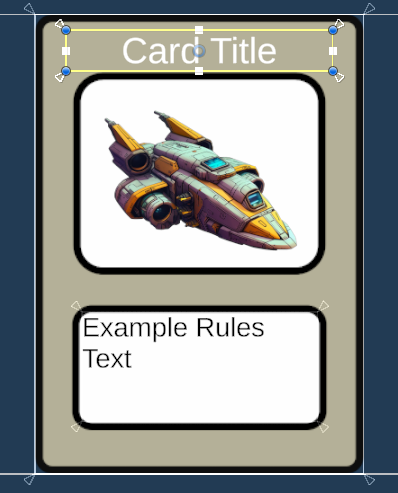
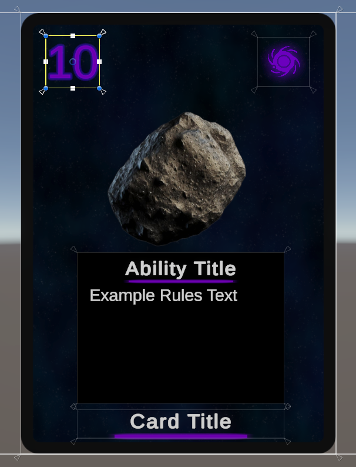

## Table of Contents

- [Getting Started & Install](https://david3214.github.io/IndieWest/tools/card-hand-toolkit/docs/quickstart.html#quick-start-install)
- [Run the Setup Wizard](https://david3214.github.io/IndieWest/tools/card-hand-toolkit/docs/quickstart.html#quick-start-wizard)
- [Create Your CardPlayable Variant](https://david3214.github.io/IndieWest/tools/card-hand-toolkit/docs/quickstart.html#quick-start-create-cardplayable)
- [Make It Play (Drawing a Card)](https://david3214.github.io/IndieWest/tools/card-hand-toolkit/docs/quickstart.html#quick-start-make-it-play)
- [Make Cards Look Like Yours (No Code)](https://david3214.github.io/IndieWest/tools/card-hand-toolkit/docs/quickstart.html#quick-start-visual-customization)
- [Add Your Own Card Data (Cost and Suit)](https://david3214.github.io/IndieWest/tools/card-hand-toolkit/docs/quickstart.html#quick-start-custom-data)
- [Next Steps](https://david3214.github.io/IndieWest/tools/card-hand-toolkit/docs/quickstart.html#quick-start-next-steps)
- [Appendix A: Card Art](https://david3214.github.io/IndieWest/tools/card-hand-toolkit/docs/quickstart.html#quick-start-art)
- [Appendix B: How Fields Show and Hide](https://david3214.github.io/IndieWest/tools/card-hand-toolkit/docs/quickstart.html#quick-start-field-visibility)

<a id="quick-start-install"></a>

# Quick Start — Section 1: Getting Started & Install

> **Goal:** Import the package and confirm its folder layout.

## Requirements

- **Unity:** 2023.1 or newer
- **Input:** Works with both Legacy and New Input System (no extra setup required)
- **Render pipeline:** URP or Built-In (HDRP not yet tested)
- **UI packages:** Requires **Unity UI (uGUI)** and **TextMeshPro** for card text and the hover overlay. They're included by default in new Unity projects (in Unity 6 TextMeshPro is part of uGUI). If either is missing, install it through **Window ▸ Package Manager**. The first time card text appears, Unity may ask you to import **TMP Essentials**. Click **Import**.
- **Platforms:** Desktop & Mobile

> **Install type:** This asset is distributed as a classic **`.unitypackage`** (not UPM). Paths below assume import into `Assets/CardHandToolkit/…`. If you import to a different folder, adjust paths accordingly.

## 1) Import the package

1. In Unity, go to **Assets ▸ Import Package ▸ Custom Package…**.
2. Select `CardHandToolkit.unitypackage`.
3. In the Import dialog, keep everything **checked** and click **Import**.

## 2) Verify folder layout

After import, you should see:

```
Assets/
└─ CardHandToolkit/
   ├─ Documentation/   # This guide + API docs
   ├─ Editor/          # Setup Wizard + editor-only utilities
   ├─ Runtime/
   │  ├─ Prefabs/
   │  │  ├─ CHT_CardToolkitLoader.prefab
   │  │  └─ CHT_CardPlayable_Template.prefab
   │  └─ ...           # Runtime scripts, materials, etc.
   └─ Samples/         # Optional sample content (scenes, helpers)
```

> **`CHT_` assets belong to the toolkit.** Anything prefixed `CHT_` (and anything in `Samples/`) is replaced when you update the package. Don't edit them directly — the Setup Wizard makes your own copies in `Assets/CardHandToolkit/Config/`, which is created the first time you run it.

**Next:** Section 2 runs the Setup Wizard to create your own copies and a first scene.

<a id="quick-start-wizard"></a>

# Quick Start — Section 2: Run the Setup Wizard

> **Goal:** Create your own copies of the toolkit's assets and a first scene to play in.

1. Go to **Tools ▸ Card Toolkit ▸ Setup Wizard**. The **Welcome** page checks your Unity version, render pipeline and input setup. The wizard saves its settings as you go, creates assets when you use the **Create** buttons, and sets up your scene when you click **Finish**.
2. On **Libraries**, click **Create** next to each of the seven fields. Each one makes your own copy in `Assets/CardHandToolkit/Config/`. Section 3 explains what each one is for.
3. On **Game Scene**, keep **Create New** and the default name, or choose **Use Existing** to set up a scene you already have. The loader and a Player Hand are always added. The Hover Presenter and **Game Camera + Background** are on by default; the camera and background are added together only when creating a new scene. The Opponent Hand and play zones are optional. Tick **Line Play Zone** if you want to play cards into a zone in Section 4. Hover over a checkbox to see what it adds.
4. On **Samples & Docs**, the documentation buttons open the online guides in your browser. Click **Finish** to complete setup.

The Wizard saves your scene with `CHT_CardToolkitLoader` (wired to your new assets), a Player Hand and anything else you ticked, and adds it to Build Settings. Press **Play** from that scene: it runs without errors, and the hand stays empty until Section 4 draws cards into it.

> **Background:** With **Game Camera + Background** enabled, the wizard adds `CHT_BackgroundCanvas`, a simple blue backdrop, and assigns its Canvas to the camera it creates using **Screen Space - Camera**. Replace the sprite on its child Image, or remove the background object from your scene. Existing scenes keep their current camera and background. The video tutorial predates this default backdrop and shows how to add a background manually.

> **Running the Wizard again** on the same scene (with **Use Existing**) rewires its loader instead of adding a second one.

> **More scenes:** Every scene with cards needs a `CHT_CardToolkitLoader`. To add one to another scene, open both scenes, then copy the loader from your Game scene's Hierarchy and paste it into the other one. When you switch scenes at runtime, the first loader persists and later ones remove themselves.

> **Errors when you press Play?** See [Troubleshooting](https://david3214.github.io/IndieWest/tools/card-hand-toolkit/docs/faq.html#troubleshooting) in the FAQ.

<a id="quick-start-create-cardplayable"></a>

# Quick Start — Section 3: Create Your CardPlayable Variant

> **Goal:** Understand and lightly customize the card prefab, card data, and visual setup that the Setup Wizard just created for you.

## 1) Review what the Wizard created

After finishing the Wizard, you now have these assets:

| Asset                            | Purpose                                                                                                                    | Default Location                 |
| -------------------------------- | -------------------------------------------------------------------------------------------------------------------------- | -------------------------------- |
| **CardPlayable_User.prefab**     | Variant of `CHT_CardPlayable_Template`, used for all cards in-game. Customize its interaction feel or swap its 3D model.   | `Assets/CardHandToolkit/Config/` |
| **CardBackMat_User.mat**         | Material for the back of cards. Its texture only shows in the editor; at runtime the back comes from the CardFrameLibrary. | `Assets/CardHandToolkit/Config/` |
| **CardFrontMat_User.mat**        | Material for the front of cards. Its textures only show in the editor; at runtime the frame and art are replaced.          | `Assets/CardHandToolkit/Config/` |
| **WorldViewPrefab_User.prefab**  | Variant of `CHT_WorldViewPrefab_Template`. Runtime display shown on cards (name, rules text, art).                         | `Assets/CardHandToolkit/Config/` |
| **CardSkin_User.asset**          | Copy of the template Card Skin. Sets the World View prefab, which fields show, scaling and colors.                         | `Assets/CardHandToolkit/Config/` |
| **CardDatabase.asset**           | Empty Card Database scriptable Object. Put all Scriptable Cards in here for the loader to build your library               | `Assets/CardHandToolkit/Config/` |
| **CardFrameLibrary.asset**       | Card Frame Library. Starts with a placeholder frame and back; replace them with your own. Plain white if a slot is empty.  | `Assets/CardHandToolkit/Config/` |
| **HoverProfile.asset**           | Hover timings and offsets for mouse and touch.                                                                             | `Assets/CardHandToolkit/Config/` |
| **CardVisualFactory_User.asset** | Copy of the template Visual Factory. Initializes cards at runtime and holds the global Card Skin + Card Prefab references. | `Assets/CardHandToolkit/Config/` |

The **CHT_CardToolkitLoader** in your Game scene now references this Visual Factory, so every card spawned at runtime will use your customized skin and prefab.

## 2) Create ScriptableCards (your card data)

1. **Create ▸ Card Toolkit ▸ Card** (e.g., `Fireball.asset`, `Goblin.asset`).
2. Fill in:
   - **Slug** (unique id)
   - **Card Name**
   - **Rules Text**
   - **Frame Key** (optional; leave empty to use the default frame)
   - **Card Art** (sprite). This is the card's illustration only, not the whole card. The frame, back and text are set up separately. **Section 5** covers how art, frames and text fit together, and [Appendix A](https://david3214.github.io/IndieWest/tools/card-hand-toolkit/docs/quickstart.html#quick-start-art) covers how to prepare your art.
   - Any custom data fields your ViewModel reads create as an Addon that will be a part of the addon list on the ScriptableCard. (We'll cover this in a later section)

> Each `ScriptableCard` represents gameplay data only; visuals are handled by the worldViewPrefab + global skin at runtime.

## 3) Add your ScriptableCards to the Card Database

1. Open `Assets/CardHandToolkit/Config/CardDatabase.asset`.
2. Add your newly created `ScriptableCard` assets (Fireball, Goblin, etc.).

This makes them discoverable to factories and draw systems.

> **Tip:** To add many cards at once, select the Card Database and click the lock icon at the top of the Inspector. Then select your cards in the Project window and drag them onto the **Cards** label in the Inspector. They're added to the end of the list.

## 4) (Optional) Tune your card prefab and smoke test it (no code)

Open **`CardPlayable_User.prefab`** to tune your game’s “feel”:

- **DragCard** – smoothing (Lerp Speed), drag plane depth, mouse/touch drag thresholds, tilt
- **CardBehaviour** – leave **Definition** empty (runtime assigns it)

> These tweaks affect **every** card instance since all cards use this single prefab. Hover timing (hover timeout, long-press delay, hover scale) lives in **HoverProfile**, not on the prefab.
>
> The shape of the hand's fan (spread, arc, card rotation) lives in a **Fan Layout Profile**. The Player Hand uses the shipped `CHT_FanLayoutProfile`. To change it, create your own from **Create ▸ Card Toolkit ▸ Config ▸ Fan Layout Profile** and assign it to the **Fan Layout** field on the **Player Hand** in your Game scene.

Then try it out:

1. Drop an instance of `CardPlayable_User` under the **Player Hand** in your Game scene and press **Play**.
2. Verify hover/drag feel with your tweaked values, and adjust until it feels right.
3. When you're done, exit Play mode and **delete the test card** from under the Player Hand. In Section 4, cards are drawn into the hand at runtime. A card placed by hand would stay in the hand with no card data, and the game's hand state wouldn't know about it.

> **Expected warning:** A card placed by hand has no card data yet, so you'll see `CardBehaviour: No definition set for card …, cannot push textures to views.` in the Console. That's normal for this test — cards drawn at runtime (Section 4) get their definition automatically.

For deeper visual customization (changing frame style, world-view prefab, etc.), see **Section 5** and the [API Reference](https://david3214.github.io/IndieWest/tools/card-hand-toolkit/docs/api.html).

---

**Next:** Section 4 will show how to add cards to the local player’s hand at runtime (auto-draw), so they bind a `ScriptableCard` and can be played.

<a id="quick-start-make-it-play"></a>

# Quick Start — Section 4: Make It Play (Drawing a Card)

> **Goal:** Automatically draw cards from a deck into the player’s hand and see them come alive with data and visuals.

## 1) How drawing works

At runtime, cards are added to hands through the **`HandStateService`**.

```csharp
HandStateService.Instance.AddCard(int seat, CardRef cardRef);
```

A `CardRef` pairs a card's **slug** (which `ScriptableCard` it is) with a unique **instance id** (which copy it is), so two copies of the same card can be in play at once.

When you call this:

1. An event is fired.
2. The Hand checks if that card already exists in the scene.
3. If not, it asks the **Visual Factory** (wired into `CHT_CardToolkitLoader`) to create it.
4. The **Visual Factory**
   - Instantiates your `CardPlayable_User.prefab`
   - Initializes its `CardBehaviour` with the `ScriptableCard`
   - Creates a ViewModel
   - Binds it to the `CardPresenter` and the global `CardSkin`
5. The card is positioned and animated by the **Card Zone** (In this case the Player Hand).

You never need to manually instantiate cards — just call **AddCard()**.

## 2) Create or use a Deck

If you don’t already have one, create a deck:

1. **Create ▸ Card Toolkit ▸ Deck List**
2. In the Inspector, add your cards to the list (ScriptableCards). Each entry is one physical card, so a list with one entry is a one-card deck. For testing, add your sample card several times (10 or more is a good start) so you can see a full hand fan out. Each copy gets its own instance id when the deck is built, so duplicates are fine.

> **Note:** The `DeckList` asset is a simple list of cards. The `Deck` class manages state (draw, discard, shuffle). Keep the `Deck` you get from `ToSlugDeck()` and draw from it for the rest of the game — calling `ToSlugDeck()` again starts a fresh deck. You choose what happens when the deck runs out by passing a policy to `ToSlugDeck()`, such as `ReshuffleOnEmpty` or `NoReshufflePolicy`.

## 3) Auto-draw on Start

The toolkit includes a helper script for this, `Samples/Scripts/Sample_DrawOnStart.cs`. To use it:

1. Open your **Game** scene and create an empty GameObject named **QuickStartManager**.
2. Add the **Sample_DrawOnStart** component to it.
3. Drag the Deck List you created in step 2 into the component's **Deck List** field.
4. (Optional) Drag `Runtime/Prefabs/CHT_DeckVisual` into your Game scene and place it beside the hand. Then drag the **CHT_DeckVisual** object from the **Hierarchy** (not the prefab from the Project window) into the component's **Visual Deck** field. The deck then shows as a pile, and drawn cards fly from it into the hand.

On the scene's **Visual Deck** component, **Max Visible Layers** defaults to `8`. It spreads the top eight cards normally and stacks any remaining cards behind the bottom visible layer, retaining every card object. `VisualDiscard` uses the same setting. Select either pile to preview its visible layers in the gizmo.

Here's what it does:

```csharp
using System.Collections;
using UnityEngine;
using CardHandToolkit.Model;

namespace CardHandToolkit.Samples
{
    // Quick Start helper: draws a few cards into the local player's hand on Start.
    public class Sample_DrawOnStart : MonoBehaviour
    {
        [SerializeField] DeckList deckList; // Assign your DeckList ScriptableObject in the inspector
        [SerializeField] VisualDeck visualDeck; // Optional: shows the deck as a pile the cards are drawn from
        [SerializeField] int drawCount = 5;
        [SerializeField] float startDelay = 2f;
        [SerializeField] float drawInterval = 0.25f;

        Deck<CardRef> deck;

        IEnumerator Start()
        {
            if (deckList == null)
            {
                Debug.LogWarning("Sample_DrawOnStart: No Deck List assigned.", this);
                yield break;
            }

            deck = deckList.ToSlugDeck(new ReshuffleOnEmpty<CardRef>());
            deck.Shuffle(); // A Deck keeps the Deck List's order until you shuffle it

            if (visualDeck)
                visualDeck.Initialize(deck);

            yield return new WaitForSeconds(startDelay);

            int localSeat = 0; // Matches the Seat Id on your PlayerHand (0 by default)
            for (int i = 0; i < drawCount; i++)
            {
                foreach (CardRef card in deck.Draw())
                    HandStateService.Instance.AddCard(localSeat, card);

                yield return new WaitForSeconds(drawInterval);
            }
        }
    }
}
```

`drawCount` cards are drawn one at a time, `drawInterval` seconds apart, after a `startDelay` pause so you can see the deck before the draw starts. Keep `drawCount` at or below the number of cards in your Deck List. Try 5–7 to see the hand fan out. If the deck runs out, `Draw()` returns only the cards it could draw.

Press **Play**. After a short pause, you’ll see cards drawn one by one into the Player Hand.

> **What you'll see.** A card is built from separate pieces, not one image:
>
> - **Frame:** the card's border and background, from the **CardFrameLibrary**. The Wizard's library starts with a grey placeholder frame.
> - **Card Art:** the sprite on the `ScriptableCard`, drawn on top of the frame. Transparent areas of the art let the frame show through, so art with no transparency covers the whole frame.
> - **Text:** the card's name and rules text, drawn by the **World View Prefab**.
> - **Back:** the card back, from the **CardFrameLibrary**. The Wizard's library starts with a placeholder back.
>
> **Section 5** shows how to replace the placeholders with your own frame, back and layout. [Appendix A](https://david3214.github.io/IndieWest/tools/card-hand-toolkit/docs/quickstart.html#quick-start-art) covers preparing your art.

## 4) Play a card

When you drag a card above the **Play Height** line, it triggers the card’s “play” action.

- Cards check every active **IPlayResolver** in the scene, lowest **Priority** first. The toolkit ships two: `LineBoardZone` and `SingleSlotZone`.
- The first one whose `TryResolvePlay` accepts the card takes it, and the card moves to that zone.
- If none accepts it, the card returns to the hand.

> **Play Height** is set on the **Player Hand** (default `1.5`) and works the same for mouse and touch. Select the Player Hand to see it as a red gizmo line in the Scene view. The Player Hand's **Hover Anchor** object has its own gizmo, marking where hovered cards rest. Keep it at or below the bottom edge of the screen to avoid flicker.

> **Priority example** (hypothetical zones): Play Zone 0, Secret Zone 5, Discard Pile 10. A played card tries the play zone first, then the secret zone, then the discard pile. If all three reject it, it stays in the hand.

## 5) What to expect

| Interaction                | Behavior                                                             |
| -------------------------- | -------------------------------------------------------------------- |
| **Hover (mouse)**          | Card lifts and scales per hover settings                             |
| **Long-press (touch)**     | Behaves like hover                                                   |
| **Drag**                   | Card follows pointer with smoothing                                  |
| **Drag Above Play Height** | Card border highlights                                               |
| **Play above height**      | Card leaves hand and moves to the play zone (if one exists in scene) |
| **No play zone**           | Card returns to hand smoothly                                        |

## 6) What’s happening under the hood

1. **HandStateService** tracks the `CardRef`s in each player's hand.
2. **SceneCardLookup** tracks existing cards in the scene.
3. The **PlayerHand** listens for add/remove events.
   1. On add, it checks if the card instance already exists in the scene. (IE returning to hand from play)
   2. If not, it calls `VisualFactory.Build(...)`.
4. The **Visual Factory** builds the prefab and initializes `CardBehaviour` + `CardPresenter`.
5. The **CardPresenter** binds to the global **Card Skin** and **ViewModel**.
6. **PlayerHand** manages layout and animation curves.
7. **Play Resolvers** handle card movement when played.

---

**Next:** In **Section 5**, you'll make cards look like yours: your own frame and back, and the name and rules text on the card. No code needed.

<a id="quick-start-visual-customization"></a>

# Quick Start — Section 5: Make Cards Look Like Yours (No Code)

> **Goal:** Replace the placeholder frame and back, see how the name and rules text get onto a card, and control which fields show.

> **Want a field the toolkit doesn't have, like Cost or Attack?** This section only works with the built-in fields: name, rules text, art and frame. A new text object needs something to fill it with data, so adding one here will just show placeholder text. **[Section 6](https://david3214.github.io/IndieWest/tools/card-hand-toolkit/docs/quickstart.html#quick-start-custom-data)** walks through adding your own field.

## 1) Use your own frame and back

1. Make your frame and back images at 1000×1400 (5:7, the card's ratio) and import them as sprites. [Appendix A: Card Art](https://david3214.github.io/IndieWest/tools/card-hand-toolkit/docs/quickstart.html#quick-start-art) has the full import settings.
2. Open `Config/CardFrameLibrary.asset`.
3. Set **Default Frame** to your frame and **Default Card Back** to your back.
4. Press **Play**. Every card now uses your frame and back.

> Card art sits on top of the frame, and its transparent areas let the frame show through. Leave transparent space wherever the frame should be visible.

## 2) How the card name gets onto the card

Card text comes from the **World View Prefab**, a small UI prefab placed on every card and reused by the hover overlay. The Wizard made yours at `Config/WorldViewPrefab_User.prefab`, a variant of `CHT_WorldViewPrefab_Template`.

Open it and select the **Title** text object. Four pieces work together to show a card's name:

| Piece                              | Where                        | What it does                            |
| ---------------------------------- | ---------------------------- | --------------------------------------- |
| **Title** text (TextMeshPro)       | Under `DesignRoot`           | The text you see on the card.           |
| **FieldToggle** (Builtin: `Title`) | On the Title object          | Shows or hides the text.                |
| **Default Card View Binder**       | Prefab root, **Title** slot  | Writes the card's name into the text.   |
| **Enabled Fields**                 | `Config/CardSkin_User.asset` | Turns the Title field on for all cards. |

**Rules Text** works the same way, with its FieldToggle set to `RulesText`. The text comes from the **Card Name** and **Rules Text** fields on each `ScriptableCard`.

## 3) Restyle and move the text

Edit the text objects in `WorldViewPrefab_User` like any UI: font, size, color, alignment and position. The World View is laid out at 1000×1400, the same size on cards and in the hover overlay, so what you see in Prefab Mode is what both show.

> **Tip (recommended):** Set your own frame and a sample card art on the prefab's **CardFrame** and **CardArt** images first, so you can lay out text against your real design. These sprites are only a preview for editing. At runtime, each card's frame and art are still set from the CardFrameLibrary and its `ScriptableCard`.

- Keep everything under **DesignRoot** so it fits and scales with the card.
- Use anchors that stretch with the card, not fixed offsets or a single corner, so text doesn't clip when the card resizes.



Press **Play** to check the result on the cards in your hand.

> Adding a new text object here won't fill it with card data. To add your own field, see **[Section 6](https://david3214.github.io/IndieWest/tools/card-hand-toolkit/docs/quickstart.html#quick-start-custom-data)**.

## 4) Turn a field off

1. Open `Config/CardSkin_User.asset`.
2. In **Enabled Fields**, untick **Rules Text**.
3. Press **Play**. The rules text is hidden on every card.

Tick it again to bring it back. The Card Skin turns fields on or off for your whole game without editing the prefab. A field also hides on its own for any card with no data for it, such as a card with empty Rules Text. [Appendix B](https://david3214.github.io/IndieWest/tools/card-hand-toolkit/docs/quickstart.html#quick-start-field-visibility) has the full rules.

## 5) Check the hover overlay

If you placed a play zone with the Wizard, play a card into it and hover it. The hover overlay uses the same World View Prefab, so it shows the same name and rules text, plus the card art and frame. Cards in your hand lift and scale instead of showing the overlay.

**Overlay size.** **Overlay Scale** on `Config/CardSkin_User.asset` sets how big the overlay appears on screen (`0.5` shows the 1000×1400 view at 500×700). It scales everything together, so the layout matches the card.

For a completely different overlay layout, assign a separate prefab to the Card Skin's **Overlay View Prefab Optional**. When it's empty, the overlay reuses the World View.

---

**Next:** In **Section 6**, you'll add a field the toolkit doesn't have built in, a **Cost**, from the card's data all the way to the screen, and then a **Suit** with its own color and icon.

<a id="quick-start-custom-data"></a>

# Quick Start — Section 6: Add Your Own Card Data (Cost and Suit)

> **Goal:** Give some cards a cost and show it on the card. Along the way you'll use every piece you need for your own game's data: an addon, a ViewModel, a ViewModel factory, a binder and a FieldToggle. Step 8 then adds suits, with a color palette and an icon.

The scripts in this section ship in `Samples/Scripts/`. Follow along with them, or write your own copies with different class names.

**How the data flows:** **addon** (data on the card) → **ViewModel** (reads it and decides what shows) → **binder** (writes it into the UI) → **FieldToggle** (shows or hides the element).

## 1) Store the cost on the card: an addon

An addon is a small piece of extra data attached to a `ScriptableCard`.

```csharp
using CardHandToolkit.Model;
using UnityEngine;

namespace CardHandToolkit.Samples
{
    // Gives a card a cost. Add it from the card's Inspector with "+ Add New Addon".
    public class Sample_CostAddon : CardAddon
    {
        [Min(0)] public int cost;
    }
}
```

1. Select a `ScriptableCard`, click **+ Add New Addon** and choose **Sample_CostAddon**.
2. Set **Cost**, for example `3`.
3. Do this for a few cards, and leave at least one card without it.

## 2) Read the cost: a ViewModel

A ViewModel turns card data into what the card displays. `Sample_CardVM` fills the same built-in fields as the toolkit's `DefaultCardVM` and adds `Cost`. It also reads a `Suit`, which [step 8](https://david3214.github.io/IndieWest/tools/card-hand-toolkit/docs/quickstart.html#quick-start-suits) covers. If you're writing your own copies, leave the suit lines out until then.

```csharp
using System;
using System.Collections.Generic;
using CardHandToolkit.Model;
using UnityEngine;

namespace CardHandToolkit.Samples
{
    // The built-in fields (same as DefaultCardVM) plus a Cost and a Suit read from Sample_CostAddon and Sample_SuitAddon.
    public sealed class Sample_CardVM : ICardViewModel
    {
        // Each must match a FieldToggle's Custom Key and an entry in the Card Skin's Enabled Custom Fields.
        public const string CostKey = "Cost";
        public const string SuitKey = "Suit";

        public event Action OnChanged;
        public string Title { get; private set; }
        public string RulesText { get; private set; }
        public Sprite ArtSprite { get; private set; }
        public Sprite CardFrameSprite { get; private set; }
        public IReadOnlyCollection<string> Capabilities => _caps;
        readonly HashSet<string> _caps = new(StringComparer.OrdinalIgnoreCase);

        public int Cost { get; private set; }
        public Sample_SuitAddon.Suit? Suit { get; private set; }

        public void Initialize(ScriptableCard card)
        {
            Title = card.cardName;
            RulesText = card.rulesText;
            ArtSprite = card.cardArt;
            CardFrameSprite = CardToolkitRuntime.Instance.FrameLibrary?.GetCardFrame(card.frameKey);

            // Only cards with the addon show the Cost element.
            var costAddon = card.GetAddon<Sample_CostAddon>();
            Cost = costAddon != null ? costAddon.cost : 0;
            SetCapability(CostKey, costAddon != null);

            var suitAddon = card.GetAddon<Sample_SuitAddon>();
            Suit = suitAddon != null ? suitAddon.suit : null;
            SetCapability(SuitKey, suitAddon != null);

            OnChanged?.Invoke();
        }

        // Change the cost at runtime (e.g. a "costs 1 less" effect). The card and its hover overlay update.
        public void SetCost(int cost)
        {
            Cost = cost;
            OnChanged?.Invoke();
        }

        public bool SetCapability(string key, bool present)
        {
            if (string.IsNullOrEmpty(key)) return false;
            bool changed = present ? _caps.Add(key) : _caps.Remove(key);
            if (changed) OnChanged?.Invoke();
            return changed;
        }
    }
}
```

Two things to notice:

- **`SetCapability(CostKey, …)`** tells the toolkit this card has a cost. Cards without the addon don't get the capability, so their Cost element stays hidden.
- **`OnChanged`** tells the card to refresh. `SetCost` raises it so a new cost shows straight away.

## 3) Use your ViewModel: a factory

The Visual Factory asks a ViewModel factory to create each card's ViewModel.

```csharp
using CardHandToolkit.Model;
using UnityEngine;

namespace CardHandToolkit.Samples
{
    // Creates a Sample_CardVM for every card. Assign it to your Visual Factory's View Model Factory SO field.
    [CreateAssetMenu(menuName = "Card Toolkit/Samples/Sample View Model Factory", order = 1100)]
    public class Sample_ViewModelFactory : ScriptableObject, ICardViewModelFactory
    {
        public ICardViewModel Create(ScriptableCard def)
        {
            var vm = new Sample_CardVM();
            vm.Initialize(def);
            return vm;
        }
    }
}
```

1. **Create ▸ Card Toolkit ▸ Samples ▸ Sample View Model Factory**.
2. Open `Config/CardVisualFactory_User.asset` and assign the new asset to **View Model Factory SO**, in place of `CHT_ViewModelFactory`.

> You only need one factory. If your game has several kinds of card, the factory decides which ViewModel each card gets.

## 4) Show the cost: a binder

The binder writes ViewModel data into the UI. `Sample_CardViewBinder` extends the toolkit's default binder, so the name and rules text keep working, and adds a Cost text. Its suit icon and suit colors are for [step 8](https://david3214.github.io/IndieWest/tools/card-hand-toolkit/docs/quickstart.html#quick-start-suits).

```csharp
using TMPro;
using UnityEngine;
using UnityEngine.UI;

namespace CardHandToolkit.Samples
{
    // DefaultCardViewBinder plus a Cost text and a Suit icon. Use it on your World View Prefab in place of DefaultCardViewBinder.
    public class Sample_CardViewBinder : DefaultCardViewBinder
    {
        [SerializeField] TMP_Text cost;
        [SerializeField] Image suitIcon;
        [SerializeField] Sprite planetIcon;
        [SerializeField] Sprite cosmicIcon;

        protected override void Refresh()
        {
            base.Refresh();

            if (ViewModel is not Sample_CardVM vm) return;

            if (cost) cost.text = vm.Cost.ToString();

            if (suitIcon && vm.Suit.HasValue)
                suitIcon.sprite = vm.Suit == Sample_SuitAddon.Suit.Planet ? planetIcon : cosmicIcon;

            // The cost and its glow take the suit's color from the Card Skin's Color Palette.
            if (vm.Suit.HasValue && Palette && Palette.TryGet(vm.Suit.Value.ToString(), out var color))
                SetTextColor(cost, color);
            else
                ResetTextColor(cost);
        }
    }
}
```

1. Open `Config/WorldViewPrefab_User.prefab`.
2. On the prefab root, remove **Default Card View Binder** (right-click ▸ **Remove Component**) and add **Sample_CardViewBinder**.
3. Assign **Title**, **Rules Text**, **Art** and **Frame**, the same as on the binder you removed. You'll assign **Cost** in the next step, and the suit fields in step 8.

> A World View should have exactly one binder. If it has two, only the first one found is used.

## 5) Add the Cost element to the card

1. In `WorldViewPrefab_User`, under `DesignRoot`, add a **Text - TextMeshPro** named **Cost** and place it where the cost should go.
2. Add a **FieldToggle** to it. Leave **Builtin** as `None` and set **Custom Key** to `Cost`.
3. On the prefab root, assign the **Cost** text to **Sample_CardViewBinder**'s **Cost** field.
4. Open `Config/CardSkin_User.asset` and add `Cost` to **Enabled Custom Fields**.

Here's a World View with several custom fields: a cost in the top corner, an icon, and an ability title above the rules text. Each element is anchored to its own area of the card, the same way as in Section 5.



## 6) Try it

Press **Play**:

- Cards with the addon show their cost.
- Cards without it don't show the Cost element.
- The hover overlay shows the cost too.

If the cost never shows, check that the FieldToggle's **Custom Key**, the **Enabled Custom Fields** entry and `CostKey` all say `Cost`. A key that's missing from the Card Skin logs a one-time warning in the Console.

> To show something only on cards _without_ a cost, or to toggle several objects from one key, see **Invert** and **Targets** in [Appendix B](https://david3214.github.io/IndieWest/tools/card-hand-toolkit/docs/quickstart.html#quick-start-field-visibility).

## 7) (Optional) Change the cost at runtime

You can get any card's ViewModel from its `CardPresenter`:

```csharp
if (card.GetComponent<CardPresenter>().ViewModel is Sample_CardVM vm)
    vm.SetCost(vm.Cost - 1);
```

The card and its hover overlay update straight away. The same pattern works for any runtime change, such as buffs, damage or counters.

<a id="quick-start-suits"></a>

## 8) (Optional) Suits: a color palette and an icon

Many games group cards into suits, colors or factions. This step gives each card a suit, shows the suit's icon, and tints the cost and its glow with the suit's color. `Sample_CardVM` and `Sample_CardViewBinder` above already handle suits, so this step is mostly setup.

### Store the suit: another addon

```csharp
using CardHandToolkit.Model;

namespace CardHandToolkit.Samples
{
    // Gives a card a suit. Add it from the card's Inspector with "+ Add New Addon".
    public class Sample_SuitAddon : CardAddon
    {
        // Each name must match a key in your Color Palette.
        public enum Suit { Planet, Cosmic }

        public Suit suit;
    }
}
```

1. Add **Sample_SuitAddon** to your cards the same way as the cost addon, and pick a **Suit**. A card can carry any number of addons.
2. Leave one card without a suit, so you can check that its icon hides.

In `Sample_CardVM`, the suit works like the cost: `Suit` is empty (`null`) on cards without the addon, and only cards with it get the `Suit` capability.

### Pick the suit colors: a Color Palette

1. **Create ▸ Card Toolkit ▸ Config ▸ Card Color Palette**, and name it, for example, `ColorPalette_User`.
2. Add one entry per suit. Each **Key** must match a suit name exactly, case included: `Planet` and `Cosmic`.
3. Open `Config/CardSkin_User.asset` and assign the palette to **Color Palette**.

The binder reads the palette through `Palette`, looks up the suit's color by name and passes it to `SetTextColor`. Both come from `DefaultCardViewBinder`.

### Show the suit icon

1. In `WorldViewPrefab_User`, under `DesignRoot`, add a **UI ▸ Image** named **SuitIcon** and place it.
2. Add a **FieldToggle** to it. Leave **Builtin** as `None` and set **Custom Key** to `Suit`.
3. On the prefab root, assign **SuitIcon** to **Sample_CardViewBinder**'s **Suit Icon**, and your two icon sprites to **Planet Icon** and **Cosmic Icon**.
4. Open `Config/CardSkin_User.asset` and add `Suit` to **Enabled Custom Fields**.

### Give the cost a glow: a TextMeshPro material preset

A TextMeshPro text's look, including any glow, is stored in a **material**, and every text that uses the material shares it. A glow added to the font's default material would show on every text in your game. Instead, give the cost its own **material preset**: a copy of the font's material. You don't need to duplicate the font.

1. Select the **Cost** text. The bottom of its Inspector shows the font's material, for example `LiberationSans SDF Material`.
2. Right-click that material's header and choose **Create Material Preset**. TextMeshPro creates a copy and assigns it to the Cost text.
3. In the Project window, rename the copy and move it into your own folder, for example `Config/`. Keep the font's name at the start of the material's name (for example `LiberationSans SDF - Glow`). The text's **Material Preset** dropdown only lists materials whose name starts with the font's name.
4. Back on the Cost text, edit the material section:
   - Set **Face ▸ Color** to white. The text's own **Color** (vertex color) tints it, and the binder sets that to the suit color.
   - Tick **Underlay**. For a glow, set **Offset X** and **Offset Y** to `0`, **Dilate** to around `0.3`–`0.6`, and **Softness** to around `0.5`–`1`. A small offset with no softness gives a drop shadow instead.
   - The alpha of the Underlay **Color** sets how strong the glow is. At runtime the binder keeps that alpha and replaces the color with the suit's.

Every other text keeps the font's default material, so nothing else changes. At runtime, `SetTextColor` makes one copy of your preset per color, shared by every card with that color, so cards don't each get their own material.

### Try it

Press **Play**:

- Each card with a suit shows its icon, and its cost takes the suit's color with a matching glow, both on the card and in the hover overlay.
- A card without a suit hides its icon, and its cost keeps its original color.

If the cost doesn't change color, check that the palette is assigned on the Card Skin and that its keys match the suit names. If the glow doesn't show, check that **Underlay** is ticked on the Cost text's material preset and that its alpha isn't 0.

> `CardColorPalette` and `SetTextColor` work for any colored text: rarity, buffed stats in green, damaged health in red.

---

**Next:** Section 7 points you to the rest of the documentation.

<a id="quick-start-next-steps"></a>

# Quick Start — Section 7: Next Steps & Resources

> You now have a working setup: cards that draw, display data, and can be played into zones!

With your toolkit configured, you can start shaping your own game’s rules, visuals, and card logic. Start with the [Concepts](https://david3214.github.io/IndieWest/tools/card-hand-toolkit/docs/api.html#concepts) in the API Reference, then use its guides for each part of the toolkit.

---

## 1) Guides

| Guide | What it covers |
| --- | --- |
| **[Zones & Play](https://david3214.github.io/IndieWest/tools/card-hand-toolkit/docs/api.html#zones--play)** | How a drag becomes a play, the example zones and their Drop Area, moving cards from code, and writing your own `IPlayResolver`. |
| **[Card Data & Decks](https://david3214.github.io/IndieWest/tools/card-hand-toolkit/docs/api.html#card-data--decks)** | Cards and copies (`CardRef`), decks, drawing, discarding and reshuffling, and `HandStateService`. |
| **[Card Visuals](https://david3214.github.io/IndieWest/tools/card-hand-toolkit/docs/api.html#card-visuals)** | How the Visual Factory, Card Skin, view model, binder and field toggles fit together; changing cards at runtime; finished card images. |
| **[Interaction](https://david3214.github.io/IndieWest/tools/card-hand-toolkit/docs/api.html#interaction)** | Hover, drag and tap; interaction policies, including turn-based rules; the Hover Profile and hover previews. |
| **[Hands & Layout](https://david3214.github.io/IndieWest/tools/card-hand-toolkit/docs/api.html#hands--layout)** | The Player Hand's focus, Play Height and reordering; opponent hands; shaping the fan. |

## 2) Where to go next

- **[API Reference](https://david3214.github.io/IndieWest/tools/card-hand-toolkit/docs/api.html)**: the guides above, plus an A–Z entry for every public type.
- **[FAQ](https://david3214.github.io/IndieWest/tools/card-hand-toolkit/docs/faq.html)**: answers to common setup and integration questions.

## 3) Community & Support

If you have questions, feedback, or want to show what you’ve built:

- **[Toolkit website](https://david3214.github.io/IndieWest/tools/card-hand-toolkit/)** — the official Card Hand Toolkit product page.
- **Discord** — [link](https://discord.gg/rC7wVukEpu) join the discussion, **Report an Issue**, or **Contact Support**.
- **Ask the CHT Assistant (GPT)** — Access via link [here](https://chatgpt.com/g/g-68f00e7f8b248191a7dd41a0089b15d7-card-hand-toolkit-assistant-cht-assistant)
- **[Watch the Quick Start Tutorial](https://youtu.be/L_v_jIwN_XA)** — Recreate the included sample game from a fresh Unity project.

---

> You’ve completed the Quick Start!  
> Your cards are now interactive, data-driven, and visually bound — the rest is pure creativity.

<a id="quick-start-art"></a>

# Appendix A: Card Art

1. **Canvas & Ratio:** Create art at 1000×1400 px (or 2000×2800 for high resolution). This is the card's 5:7 ratio and the World View's layout size, so art at this size lines up 1:1 with your layout. Other 5:7 sizes work too, but keep both sides a multiple of 4: GPU texture compression needs it, and Unity leaves other sizes uncompressed on some platforms, using much more memory.
2. **Transparency:** Card art (on each `ScriptableCard`) should have a transparent background (PNG with alpha), so the frame shows through around it.
3. **Edge Safety:** Keep important content at least 100 px from every edge to avoid bevel clipping.
4. **Pivot:** Keep the sprite pivot centered (0.5, 0.5).
5. **Import Settings** (all card art, frames and backs):
   - Texture Type: `Sprite (2D and UI)`
   - Sprite Mode: `Single`
   - sRGB (Color Texture): `Checked`
   - Pixels Per Unit: `100` (or higher for sharper detail)
   - Filter Mode: `Bilinear` or `Trilinear`
   - Compression: ASTC 6×6 (mobile) / BC7 (PC/console), or none for maximum quality
6. **Where each piece comes from:**
   - **Card Art:** the **Card Art** field on each `ScriptableCard`.
   - **Card Frame:** the `CardFrameLibrary`, chosen by the card's **Frame Key**. Leave it empty to use the **Default Frame**. A key that doesn't match any entry also uses the default, so check the spelling if a card shows the wrong frame. Extra **Frames** entries let different cards use different frames (think of how MTG frames change with a card's color).
   - **Card Back:** the **Default Card Back** in the `CardFrameLibrary`. To switch every card to a different back at runtime, call `CardToolkitRuntime.Instance.SetGlobalBackOverride(key)` with a key from the library's **CardBacks** list.
   - **Materials:** the textures on **CardFrontMat_User** and **CardBackMat_User** only affect how cards look in the editor. At runtime the frame, art and back come from the sources above, and any part with no source shows plain white.
7. **On the hover overlay:** cards in the scene draw their art and frame on the card mesh. The **Art** and **Frame** images in the World View Prefab are only used by the hover overlay, which has no 3D card.

<a id="quick-start-field-visibility"></a>

# Appendix B: How Fields Show and Hide

Both the **CardPresenter** (cards in the scene) and the **HoverPresenter** (the hover overlay) decide which elements of the World View are visible:

1. The presenter collects every **FieldToggle** in the World View.
2. An element with a **Builtin** field shows when that field is ticked in the Card Skin's **Enabled Fields** _and_ the ViewModel has data for it (for example, non-empty Rules Text).
3. An element with a **Custom Key** shows when that key is in the Card Skin's **Enabled Custom Fields** _and_ in the ViewModel's **Capabilities**.
4. Anything else is hidden.

- **Keys aren't case-sensitive.** If your ViewModel reports a key that isn't in the Card Skin's **Enabled Custom Fields**, you'll get a one-time warning in the Console.
- **Targets:** by default a FieldToggle shows or hides its own GameObject. Fill its **Targets** list to toggle other objects instead.
- **Invert:** tick **Invert** to flip the result, so the element shows when the field is _missing_ and hides when it's present. This is useful for fallbacks and layout swaps. For example, give two elements the custom key `"Creature"`: a normal toggle on the attack/health badges and an inverted toggle on a larger rules-text box. Creatures then show their stats, and every other card shows the larger text box.

> This means you rarely need show/hide code: set up the FieldToggles and Card Skin, and the presenters show whatever each card has data for.
